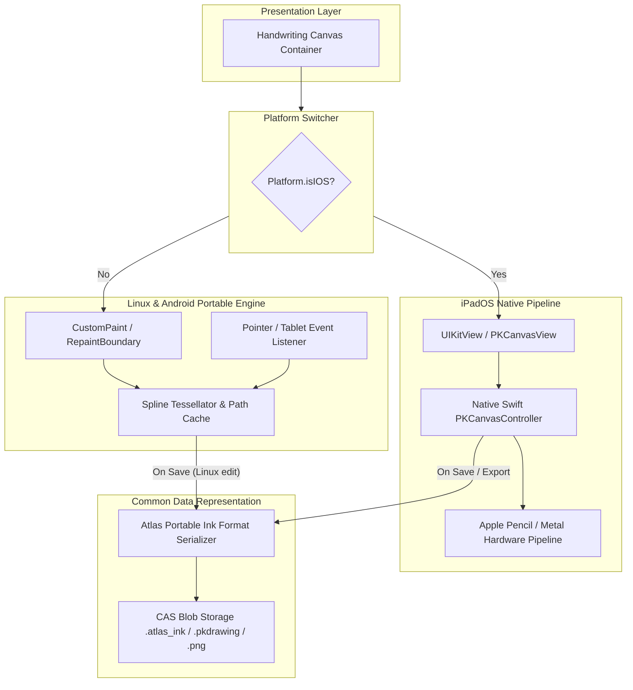
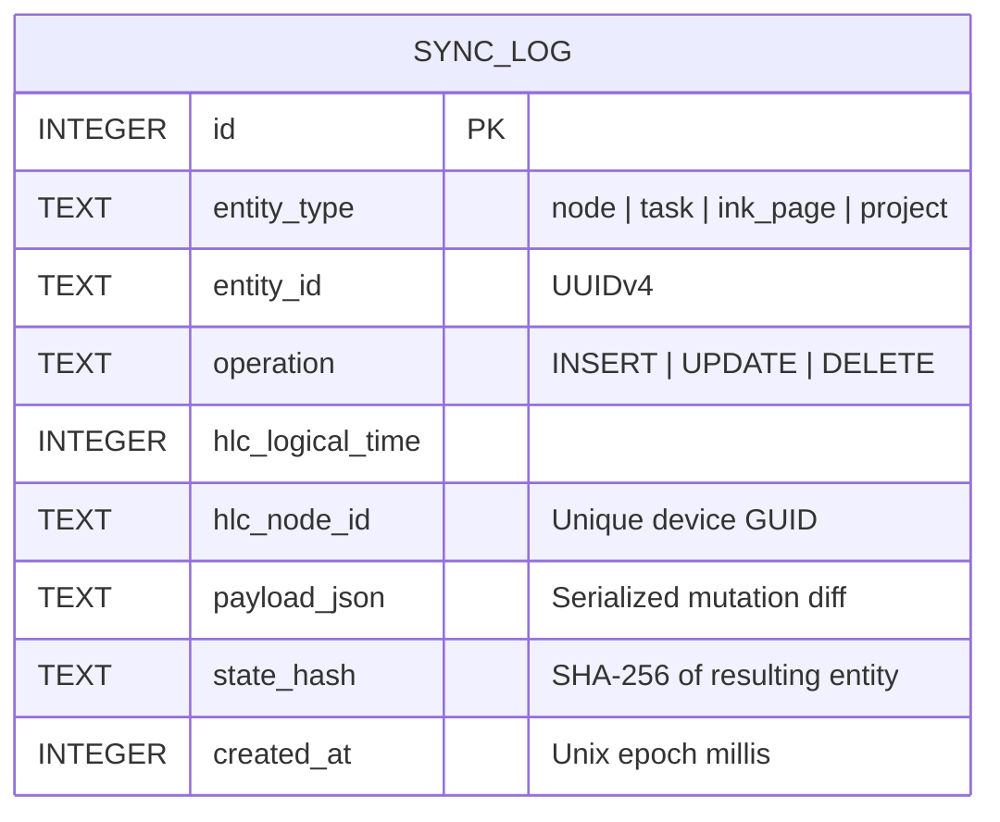
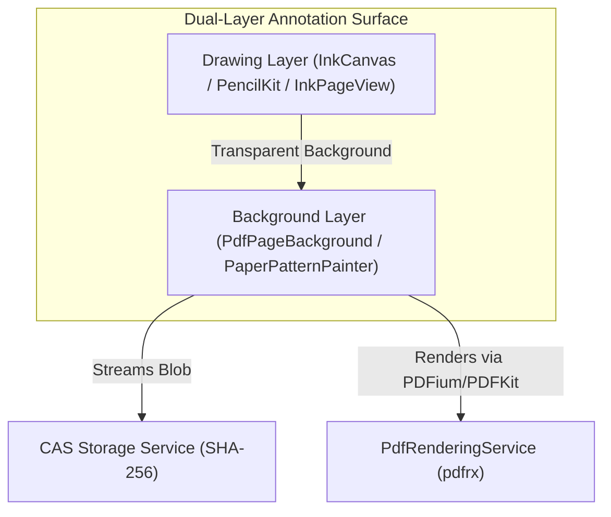
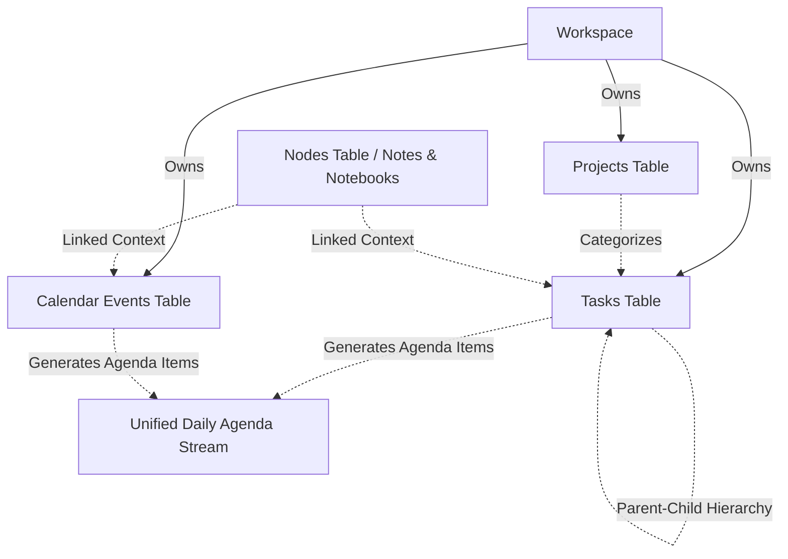
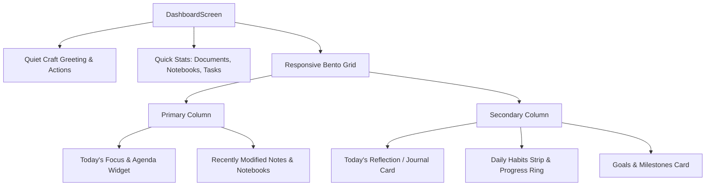
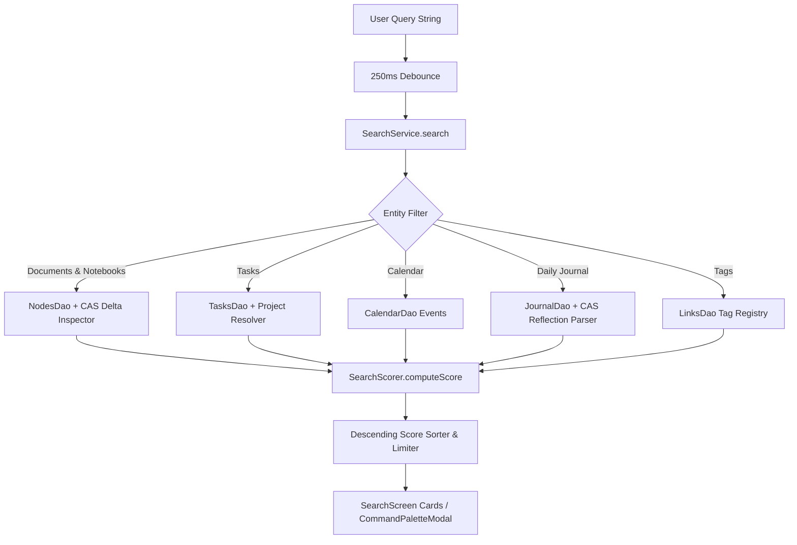
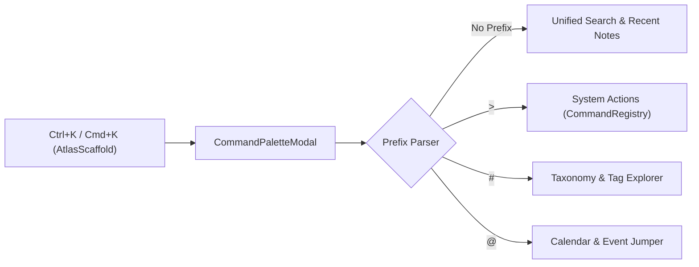
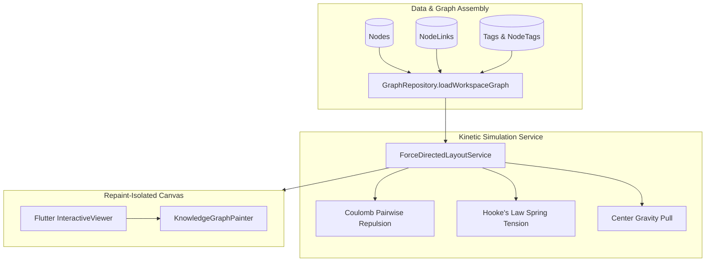

# ATLAS — Architectural Specification

## 1. Architectural Philosophy & Principles

ATLAS is architected as a **Local-First, Modular, Feature-First** application built on Flutter and Dart.

```mermaid
flowchart TD
    subgraph UI_Layer [Presentation Layer]
        Widgets[Flutter Widgets & Screens]
        Controllers[Riverpod Notifiers / StateNotifier]
        DesignSystem[Atlas Design System & Theme]
    end

    subgraph Domain_Layer [Domain Layer - Pure Dart]
        Entities[Entities & Value Objects (Freezed)]
        UseCases[Use Cases & Domain Services]
        RepoInterfaces[Repository Interfaces]
        InkMath[Ink Math & Spline Tessellator]
    end

    subgraph Data_Layer [Data Layer]
        RepoImpl[Repository Implementations]
        DriftDB[Drift ORM Database (SQLite)]
        FTS5Engine[SQLite FTS5 Full-Text Search]
        CASStorage[File-System CAS Storage (Blobs/Ink/PDF)]
        PlatformAdapters[Platform Channel Adapters]
    end

    subgraph Platform_Layer [Platform Specific Services]
        PencilKitBridge[iPadOS PencilKit Native Bridge (Swift)]
        LinuxPlatform[Linux GTK / Native Integrations]
        AndroidPlatform[Android Native File & Notification Services]
    end

    Widgets --> Controllers
    Controllers --> UseCases
    UseCases --> RepoInterfaces
    RepoInterfaces <|.. RepoImpl
    RepoImpl --> DriftDB
    RepoImpl --> FTS5Engine
    RepoImpl --> CASStorage
    RepoImpl --> PlatformAdapters
    PlatformAdapters --> PencilKitBridge
    PlatformAdapters --> LinuxPlatform
    PlatformAdapters --> AndroidPlatform
```

### Core Tenets
1. **Local-First Source of Truth:** All user data, metadata, relations, and settings reside in a local SQLite database (`atlas.db`) and local filesystem storage. The app is fully functional without internet access.
2. **Feature-First Modularity:** Code is organized by domain features (`features/handwriting`, `features/notes`, `features/tasks`, etc.) rather than technical layers (`widgets/`, `models/`).
3. **Strict Layer Separation:**
   - **Presentation Layer:** Pure Flutter UI. Observes Riverpod providers. Emits user actions to controllers. No direct database or file system calls.
   - **Domain Layer:** Pure Dart. Zero Flutter UI dependencies. Houses core entities, value objects, business logic, ink math calculations, and repository contracts. Highly unit-testable.
   - **Data Layer:** Implements repository contracts. Coordinates Drift SQLite queries, SQLite FTS5 index updates, and filesystem I/O.
4. **Content-Addressable Storage (CAS) for Heavy Blobs:** Binary ink drawings, high-resolution PNG previews, and imported PDF attachments are stored in a managed local directory addressed by their SHA-256 hash. The SQLite database stores only the hash references, file paths, and relational metadata.
5. **Platform Independence Behind Interfaces:** Platform-specific APIs (such as iOS PencilKit) are strictly encapsulated behind abstract Dart interfaces (`InkPlatformService`).

---

## 2. Directory & Package Structure

```
lib/
├── app.dart                        # Root MaterialApp & router initialization
├── main.dart                       # Entry point, dependency initialization
├── core/                           # Shared infrastructure across features
│   ├── constants/                  # App constants, defaults, limits
│   ├── database/                   # Drift database definition, tables, DAOs
│   │   ├── app_database.dart       # Drift database class
│   │   ├── app_database.g.dart     # Generated Drift code
│   │   ├── connection/             # Native SQLite connection setup (Linux/iOS/Android)
│   │   ├── daos/                   # Feature-specific Data Access Objects
│   │   └── tables/                 # Table definitions
│   ├── errors/                     # Failure types, exceptions, error handlers
│   ├── router/                     # go_router configuration, route definitions
│   ├── storage/                    # Content-Addressable Storage (CAS) manager
│   ├── sync/                       # Sync log, change vector models, HLC
│   └── theme/                      # Atlas Design System tokens, typography, colors
├── features/                       # Feature-first modular packages
│   ├── dashboard/                  # Dashboard widgets, agenda, quick notes
│   ├── document/                   # Rich-text block editor (AppFlowy Editor wrapper)
│   ├── graph/                      # Knowledge graph visualization & backlink resolution
│   ├── habits/                     # Habit tracking, logs, streaks
│   ├── handwriting/                # Ink engine, canvas, stroke smoothing, PencilKit bridge
│   │   ├── domain/                 # Ink models, stroke points, spline algorithms
│   │   ├── data/                   # Ink document serializer, file persistence
│   │   └── presentation/           # Canvas widgets, tool palettes, native platform view
│   ├── notebooks/                  # Notebook hierarchy, chapters, pages, templates
│   ├── pdf/                        # PDF viewing (pdfrx) and ink annotation overlay
│   ├── search/                     # FTS5 search queries, command palette
│   └── tasks/                      # Tasks, projects, reminders, calendar views
└── platform/                       # Native platform channels & plugin bridges
    ├── ios/                        # iOS-specific method channels & view factories
    ├── linux/                      # Linux-specific integrations
    └── android/                    # Android-specific integrations
```

---

## 3. State Management & Unidirectional Data Flow

ATLAS uses **Riverpod** with code generation (`riverpod_annotation`, `riverpod_generator`).

```mermaid
sequenceDiagram
    participant User
    participant Widget as Flutter View (ConsumerWidget)
    participant Controller as Riverpod Notifier (@riverpod)
    participant Repo as Repository Implementation
    participant DB as Drift (SQLite) & CAS
    participant Stream as Reactive Stream (Drift Watcher)

    User->>Widget: Interacts (e.g., completes a task)
    Widget->>Controller: Invokes toggleTaskCompletion(id)
    Controller->>Repo: Calls updateTask(task)
    Repo->>DB: Executes UPDATE tasks SET completed = 1
    DB-->>Stream: Drift reactive table trigger fires
    Stream-->>Controller: Emits updated List<Task>
    Controller-->>Widget: Notifier updates state; Widget rebuilds
```

### State Layer Conventions:
- **`AsyncNotifier<T>`:** Used for all asynchronous business operations that load, mutate, or fetch data.
- **Provider Scoping:** View-specific states (e.g., active zoom level, current tool selection) use local auto-dispose providers.
- **Drift Reactive Watchers:** Drift `watch()` streams are directly mapped to Riverpod `StreamProvider` or integrated into `AsyncNotifier` subscriptions, guaranteeing zero desynchronization between database state and UI.

---

## 4. Platform Abstraction & Handwriting Engine Architecture

Handwriting requires radically different execution models across target platforms:



### Interface Definition (`InkPlatformService`)
```dart
abstract class InkPlatformService {
  /// Whether native hardware acceleration (PencilKit) is available
  bool get hasNativeHardwareSupport;

  /// Loads an ink page into the active platform drawing context
  Future<void> loadDrawing({
    required String pageId,
    required String? rawPencilKitBlobPath,
    required String portableInkBlobPath,
  });

  /// Exports the current canvas state into native, portable, and preview formats
  Future<InkExportResult> exportDrawing({
    required String pageId,
    required double scale,
  });

  /// Dispatches tool changes (pen, highlighter, eraser, width, color)
  Future<void> setTool(InkToolConfig tool);

  /// Performs undo/redo operations
  Future<void> undo();
  Future<void> redo();
}
```

---

## 5. Storage Subsystem & Content-Addressable Storage (CAS)

To guarantee that SQLite database size remains compact and performance does not degrade when storing thousands of high-resolution drawings and PDFs:

1. **Relational Data (SQLite):**
   - Stored in `~/.local/share/atlas/atlas.db` (Linux), `ApplicationDocumentsDirectory/atlas.db` (iOS/Android).
   - Only stores string metadata, relational links, titles, tags, tasks, and file hashes.
2. **Binary Blobs (CAS Store):**
   - Stored in `.../atlas/blobs/ab/cd/abcdef123456...`.
   - Files are partitioned using the first two characters of their SHA-256 hash to prevent directory traversal performance hits.
   - De-duplication: Identical attachments or template backgrounds share the same physical storage file.

---

## 6. Synchronization Strategy (Future-Ready Architecture)

While cloud infrastructure is deferred to future milestones, ATLAS implements a **Sync-Ready Foundation** from day one:



### Sync Principles:
- **Hybrid Logical Clocks (HLC):** Replaces physical wall-clock timestamps for conflict ordering. HLC provides causality tracking across offline devices without time-drift anomalies.
- **Tombstone Strategy:** Deletions do not wipe rows immediately; they mark `is_deleted = 1` and record a tombstone in `sync_log`.
- **Blob Sync:** Handled out-of-band via hash manifest comparison. Small metadata records sync first, heavy binary blobs download on-demand.

---

## 7. Rich Text & Knowledge Graph Architecture (Milestone 3)

### 7.1 Rich Text Engine (`flutter_quill`)
- **Package Selection:** `flutter_quill: ^11.6.0` (Apache-2.0) adopted behind the ATLAS `DocumentContentService` abstraction. Replaced `appflowy_editor` due to Flutter 3.47+ compilation break (`TextInputClient.onFocusReceived`).
- **Content Storage:** Delta JSON documents are serialized and stored in Content-Addressable Storage (CAS) referenced by `nodes.content_hash`. SQLite stores metadata while CAS guarantees immutability, de-duplication, and instant snapshotting.
- **Autosave & Navigation Safety:**
  - 1-second debounced autosave timer resets on user typing.
  - Asynchronous save mutex (`_isSaving`, `_saveQueued`) prevents racing writes.
  - `PopScope` intercepts back navigation to flush pending changes before screen exit.

### 7.2 Wiki-Links & Bidirectional Backlinks
```mermaid
flowchart LR
    Doc[Document / Editor] -->|Types [[Note]]| Parser[WikiLinkParser]
    Parser -->|Regex Matches| LinkRepo[LinkRepository]
    LinkRepo -->|Search Titles| NodesDao[NodesDao]
    LinkRepo -->|Insert / Sync Links| LinksDao[LinksDao / NodeLinks]
    LinksDao -->|Watch Backlinks Stream| BacklinksPanel[BacklinksPanel Widget]
    BacklinksPanel -->|Click Target| Router[GoRouter Navigate]
```
- **Wiki-Link Syntax:** Supports standard `[[Note Title]]` and aliased `[[Target Note|Custom Display Text]]`.
- **Reactive Backlinks Stream:** `LinksDao.watchBacklinksForTarget(nodeId)` joins `node_links` with `nodes` to provide a real-time stream of incoming references sorted by update timestamp.
- **Cross-Feature Interoperability:** Embedded in both `DocumentEditorScreen` and `NotebookEditorScreen` (via bottom sheet on iPadOS/Linux/Android).

---

## 8. Notebook & PDF System Architecture (Milestone 4)

### 8.1 PDF Engine & Coordinate System
- **Engine Selection:** `pdfrx: ^2.12.0` (MIT license, no AGPL dependencies). Backed by Google's native **PDFium** on Linux desktop, Android, and Windows, and Apple's native **PDFKit** on iPadOS/iOS.
- **Coordinate System Alignment:**
  - Standard PDF dimensions are expressed in PDF points ($1/72\text{ inch}$).
  - Standard A4 is $595.28 \times 841.89\text{ pt}$, US Letter is $612.0 \times 792.0\text{ pt}$.
  - The ATLAS Ink Engine operates at a $1.0\text{ canvas unit} = 1.0\text{ PDF point}$ ratio, providing zero-distortion 1:1 overlay precision.



### 8.2 PDF Import & Scaffolding Pipeline
1. **User Action:** Selects local `.pdf` file via `file_picker`.
2. **CAS Ingestion:** `PdfRepository` hashes and writes the raw PDF binary into CAS blob storage.
3. **Structure Inspection:** `PdfRenderingService.openBytes(pdfBytes)` extracts page count and exact bounding dimensions for each page.
4. **Notebook Scaffolding:**
   - Creates parent `notebook` record in `nodes`.
   - Creates metadata entry in `pdf_documents`.
   - Creates container in `ink_documents`.
   - Inserts individual `ink_pages` matching the exact width and height of each PDF page with `pdfDocumentId`, `pdfSourceHash`, and `pdfPageIndex`.

### 8.3 Multi-Page Notebook Architecture
- **Page Manager Drawer (`NotebookPageDrawer`):**
  - Displays cached raster thumbnail previews for every page.
  - Supports dynamic page navigation, reordering, arbitrary page insertion below, page duplication, and page deletion.
  - Stationery template picker (ruled, grid, dot grid, blank) with customizable millimeter/point spacing.
- **Contiguous 1-Based Page Indexing:**
  - Database operations (`batchReorderPages`, `insertPageAt`, `deletePageAndReorder`) maintain strict contiguous 1-based page numbering to eliminate numbering gaps.

### 8.4 PDF Export Pipeline (`PdfExportService`)
- Uses the `pdf: ^3.13.1` (Apache-2.0) package to composite background stationery/PDF page rasters and vector ink strokes into standard PDF documents.
- Offscreen rasterizer (`renderCompositePageImage`) scales to $2.0\times$ device resolution for publication-quality output.
- Outputs `.pdf` to local filesystem with instant user notification.

### 8.5 Platform Boundary Integrity
- **Linux Desktop:** Full interactive vector handwriting canvas (`InkCanvas` + `InkToolPalette`) stacked over `PdfPageBackground`.
- **iPadOS:** Full hardware-accelerated Apple Pencil support (`PencilKit`) stacked over `PdfPageBackground`.
- **Android Companion:** Strictly read-only viewer (`InkPageView` with pinch-to-zoom and pan) stacked over `PdfPageBackground`. Zero editing or stroke capture capabilities.

---

## 9. Tasks, Calendar & Reminders Architecture (Milestone 5)

### 9.1 Unified Productivity Model & Relational Schema


- **Tasks & Subtask Hierarchy:**
  - `parent_task_id` self-references `tasks.id` with `ON DELETE CASCADE`. Primary task views (Inbox, Today, Upcoming, Projects) automatically exclude subtasks to keep views organized. Subtasks are rendered inside `TaskDetailSheet` with live progress bars.
- **Relational Integrity:**
  - `project_id` and `node_id` use `ON DELETE SET NULL`, preserving tasks when projects or associated notes are removed.
- **Node-Level Task Embedding:**
  - `NodeTasksPanel` allows creating and managing tasks directly inside `DocumentEditorScreen` and `NotebookEditorScreen`.

### 9.2 Unified Calendar & Agenda Pipeline
- **Package Selection:** `table_calendar: ^3.3.0` (Apache-2.0, zero AGPL dependencies). Provides month grid, 2-week view, and week view with custom markers.
- **Chronological Stream Merging:**
  - `CalendarRepository.watchAgendaForDay` uses `Rx.combineLatest2` to join `CalendarDao.watchEventsForDay` and `TasksDao.watchTasksForWorkspace`.
  - All-day events and tasks sort to the top, followed by timed items sorted ascending by start time.
- **Responsive Layout Adaptation:**
  - **Linux Desktop (`width >= 900`):** Two-column split layout with a fixed monthly calendar on the left ($380\text{ px}$) and an expansive daily agenda timeline on the right.
  - **iPadOS (`600 <= width < 900`):** Adaptive split view with quick jumping.
  - **Android Companion (`width < 600`):** Collapsible week-strip calendar header with a vertical scrollable daily agenda. Full task checking, creation, and event scheduling are supported.

### 9.3 Local Notifications & Reminders Engine
- **Package Selection:** `flutter_local_notifications: ^23.0.0` (BSD-3-Clause) paired with `timezone: ^0.11.2`.
- **Encapsulated Service (`NotificationService`):**
  - **Linux Desktop:** Initializes via native DBus notifications daemon (`defaultActionName: 'Open ATLAS'`).
  - **Android:** Requests exact alarm permissions (`schedule_exact_alarm`) and configures high-importance notification channels (`AndroidScheduleMode.exactAllowWhileIdle`).
  - **iOS / iPadOS:** Registers `UNUserNotificationCenter` delegates.
- **Lifecycle & Reconciliation:**
  - `dueDate - reminderMinutesBefore` triggers `zonedSchedule`.
  - Completing or deleting a task/event automatically cancels pending notifications.
  - `bootstrap.dart` runs startup reconciliation (`reschedulePendingReminders`) to ensure all upcoming tasks and events maintain active notification triggers after device reboots.
  - Gracefully degrades without exceptions if permissions are denied or notification daemons are absent.

---

## 10. Personal Dashboard, Habits & Daily Journal Architecture (Milestone 6)

### 10.1 Modular Dashboard & Bento-Grid Layout


- **Responsive Multi-Card Layout:**
  - **Linux Desktop (`width >= 960`):** Multi-column bento-grid. Focus & Agenda and Recent Notes on the left ($5\text{ flex}$); Journal, Habits Strip, and Goals on the right ($4\text{ flex}$).
  - **Tablet & Mobile (`width < 960`):** Single-column stacked feed prioritizing today's journal reflection and habits strip, followed by agenda, goals, and recent notes.
- **Header & Quick Action Bar:**
  - Time-of-day greeting ("Good morning / afternoon / evening") with localized full date.
  - One-tap quick actions: "New Note", "New Task", and "Today's Journal".

### 10.2 Habit Tracking & Streak Engine
- **Lightweight Custom Painting:**
  - `HabitProgressRingPainter` (< 100 lines, zero external dependencies) renders smooth circular progress arcs with custom stroke widths and round caps.
  - Encapsulated in `HabitProgressRing` with `RepaintBoundary` for optimal GPU layer caching.
- **Streak Calculation Algorithm:**
  - **Current Streak:** Contiguous chain of days ending on today (or yesterday if today is not yet checked in). If yesterday was missed, current streak is 0 (or 1 if checked today).
  - **Best Streak:** Computed across the entire sorted set of completed log dates by detecting contiguous single-day increments.
  - **Weekly History:** Emits a 7-day completion map rendered via `HabitWeeklyTracker` with weekday initials and status dots.
  - **Idempotency:** Composite unique key `(habit_id, log_date)` prevents duplicate records on concurrent or repeated toggles.

### 10.3 Daily Journal Engine & Contextual Day Scaffolding
- **Date-Linked Scaffolding:**
  - When the user taps "Today's Journal", `JournalRepository.getOrCreateTodayJournalNode` resolves whether a journal document exists for today's date (`YYYY-MM-DD`).
  - If not found: Scaffolds a new document node in `nodes` (`type: 'document'`, title: `Journal: [Formatted Date]`), writes standard starter sections into CAS via `DocumentContentService` (`# Journal: ...`, `## Daily Focus`, `## Key Wins`, `## Reflections`), and inserts a row into `journal_entries`.
  - If found: Reuses the existing node and navigates directly to `DocumentEditorScreen`.
- **Contextual Day Summary Panel:**
  - `JournalContextDayPanel` automatically detects when a document is linked to `journal_entries`.
  - Renders an embedded panel displaying all tasks completed and habits fulfilled on that specific date.

---

## 11. Global Search, Command Palette & Knowledge Graph Architecture (Milestone 7)

### 11.1 Unified Global Search Engine & Relevance Scorer



- **Relevance Scoring Rubric (`SearchScorer`):**
  - **Exact Title Match:** $100\text{ pts}$ (case-insensitive full title equality).
  - **Prefix Title Match:** $80\text{ pts}$ (title starts with search query).
  - **Word-Prefix Match:** $70\text{ pts}$ (any word token in title starts with query).
  - **Tag / Project Match:** $60\text{ pts}$ (associated tag name or parent project matches query).
  - **Content Body Match:** $40\text{ pts}$ (substring match in CAS Delta JSON plain text).
  - **Fuzzy Subsequence Match:** $25\text{ pts}$ (characters of query appear in sequential order).
  - **Recency Boost:** $+1.0$ to $+10.0\text{ pts}$ scaled inversely with days elapsed since `updatedAt` ($\text{boost} = \max(1.0, 10.0 - 0.3 \times \text{days})$).
- **Contextual Snippet Extraction:**
  - `SearchScorer.extractSnippet` locates the first match index in the entity body and returns an ellipsis-bounded contextual window of ~60-80 characters.
- **Search UI (`SearchScreen`):**
  - Instant debounced search-as-you-type ($250\text{ ms}$).
  - Filter chips (`All`, `Documents`, `Notebooks`, `Tasks`, `Calendar`, `Journal`).
  - Rich result cards with entity-specific colored badge icons, highlighted matching words, parent breadcrumbs, and relative timestamps.
  - Full keyboard accessibility: Arrow Up/Down navigation, Enter to open, Escape to clear.

### 11.2 Universal Command Palette



- **Global Hotkey Registration:**
  - `CallbackShortcuts` in `AtlasScaffold` binds `LogicalKeyboardKey.keyK` with `controlPressed` or `metaPressed`.
  - Mobile & compact fallback: Floating action pill and quick sidebar launcher trigger `CommandPaletteModal.show(context)`.
- **Backdrop Blur & Modal Presentation:**
  - Centered floating dialog constrained to $640\text{ px}$ width with backdrop blur (`BackdropFilter` with `sigmaX: 8, sigmaY: 8`) and dark/light surface elevations.
- **Mode Prefixes:**
  - `> `: Filters actions from `CommandRegistry` (Navigation, Quick Creation, Theme Toggling, Knowledge Graph).
  - `# `: Queries workspace tags from `LinksDao` and provides 1-tap navigation to filtered graph exploration.
  - `@ `: Surfaces today's agenda, date jumping, and upcoming calendar appointments.
  - *No prefix (unified)*: Combines recent notes, top actions, and cross-entity search results.

### 11.3 Interactive 2D Knowledge Graph Architecture



- **Self-Contained Physics Engine (`ForceDirectedLayoutService`):**
  - Lightweight (< 250 lines, actual 171 lines) Fruchterman-Reingold / Verlet particle simulation.
  - **Repulsion:** Coulomb repulsion between all node pairs ($F_{\text{rep}} = \frac{k_r}{d^2 + 10}$) pushes disconnected nodes apart and prevents node overlapping.
  - **Attraction:** Hooke's law spring tension ($F_{\text{att}} = k_s \cdot (d - l_0) \cdot w$) along bidirectional edges pulls linked ideas together.
  - **Centering & Damping:** Central gravitational force ($F_{\text{grav}} = (C - P) \cdot g$) prevents disconnected clusters from drifting off-screen; velocity damping ($0.85$) smoothly dissipates kinetic energy.
  - **Equilibrium Detection:** Computes total kinetic energy $E_k = \sum (v_x^2 + v_y^2)$. Automatically halts the simulation ticker once $E_k < 0.04$, ensuring zero unnecessary battery drain or CPU load when the graph reaches rest.
- **Visual Encoding:**
  - **Documents:** Accent Blue (`AtlasColors.accentBlue`).
  - **Notebooks:** Accent Sage (`AtlasColors.accentSage`).
  - **Tags:** Accent Amber (`AtlasColors.accentAmber`).
  - **Degree-Scaled Radius:** Node radius scales dynamically between $4\text{ px}$ and $16\text{ px}$ proportional to connectivity degree ($\text{in-degree} + \text{out-degree}$).
  - **Subtle Edges:** Direction-neutral low-opacity edges with real-time glow highlighting when incident nodes are hovered or selected.
- **Interactive Controls:**
  - Smooth pinch-to-zoom and pan navigation backed by Flutter's native `InteractiveViewer`.
  - Real-time node dragging: drags wake up the physics simulation ticker and update adjacent spring tensions dynamically.
  - Node hover and tap listeners: click navigates directly to `/documents/:id` or `/notebooks/:id`.
  - Filter capsule: Type toggles (`Docs`, `Notebooks`, `Tags`), orphan node toggle (`Icons.scatter_plot`), and live text search filter.
- **Embedded 1-Hop Local Graph (`LocalGraphPanel`):**
  - Integrated into `DocumentEditorScreen` and `NotebookEditorScreen` (backlinks sheet).
  - `GraphRepository.extractNeighborhood` extracts a localized 1-hop subgraph around the current node.
  - Supports quick contextual visual discovery of interconnected ideas directly from the active note editor.


