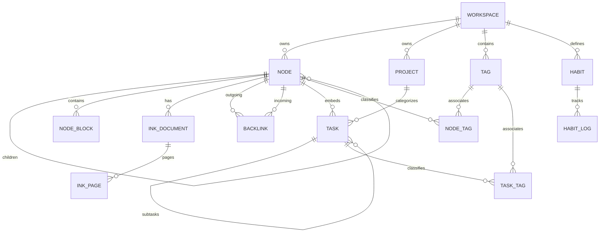

# ATLAS — Database Schema Specification

## 1. Storage Engine Overview

ATLAS uses **SQLite 3** as its primary structured storage engine, accessed via the **Drift** ORM in Dart.

### Database Configuration & PRAGMAs
At initialization, the database connection executes:
```sql
PRAGMA journal_mode = WAL;
PRAGMA synchronous = NORMAL;
PRAGMA foreign_keys = ON;
PRAGMA temp_store = MEMORY;
PRAGMA mmap_size = 30000000000;
PRAGMA cache_size = -64000; -- 64MB memory cache
PRAGMA busy_timeout = 5000;
```

---

## 2. Entity-Relationship Model



---

## 3. SQLite DDL Schema

### 3.1 Workspace & Node Core Tables

```sql
-- Workspaces allow multiple isolated vaults/knowledge bases
CREATE TABLE workspaces (
    id TEXT PRIMARY KEY NOT NULL, -- UUIDv4
    name TEXT NOT NULL,
    icon TEXT,
    settings_json TEXT NOT NULL DEFAULT '{}',
    created_at INTEGER NOT NULL,
    updated_at INTEGER NOT NULL,
    is_deleted INTEGER NOT NULL DEFAULT 0
);

-- Nodes represent any hierarchical structural entity (Folders, Documents, Notebooks, Canvas)
CREATE TABLE nodes (
    id TEXT PRIMARY KEY NOT NULL, -- UUIDv4
    workspace_id TEXT NOT NULL REFERENCES workspaces(id) ON DELETE CASCADE,
    parent_id TEXT REFERENCES nodes(id) ON DELETE CASCADE,
    type TEXT NOT NULL, -- 'folder' | 'document' | 'notebook' | 'database' | 'journal'
    title TEXT NOT NULL,
    icon TEXT,
    cover_image_hash TEXT,
    sort_order REAL NOT NULL DEFAULT 0.0,
    is_favorite INTEGER NOT NULL DEFAULT 0,
    is_pinned INTEGER NOT NULL DEFAULT 0,
    is_archived INTEGER NOT NULL DEFAULT 0,
    is_deleted INTEGER NOT NULL DEFAULT 0,
    metadata_json TEXT NOT NULL DEFAULT '{}',
    created_at INTEGER NOT NULL,
    updated_at INTEGER NOT NULL
);

CREATE INDEX idx_nodes_workspace_parent ON nodes(workspace_id, parent_id, sort_order);
CREATE INDEX idx_nodes_type ON nodes(workspace_id, type);
CREATE INDEX idx_nodes_updated ON nodes(updated_at DESC);
```

### 3.2 Rich-Text Document Blocks

```sql
-- Block-level storage for Notion-style documents
CREATE TABLE node_blocks (
    id TEXT PRIMARY KEY NOT NULL, -- UUIDv4
    node_id TEXT NOT NULL REFERENCES nodes(id) ON DELETE CASCADE,
    parent_block_id TEXT REFERENCES node_blocks(id) ON DELETE CASCADE,
    type TEXT NOT NULL, -- 'paragraph' | 'heading_1' | 'heading_2' | 'heading_3' | 'bullet_list' | 'numbered_list' | 'todo' | 'code' | 'callout' | 'quote' | 'divider' | 'ink_canvas' | 'pdf_embed'
    content_json TEXT NOT NULL, -- Delta or AppFlowy node attributes
    sort_order REAL NOT NULL DEFAULT 0.0,
    created_at INTEGER NOT NULL,
    updated_at INTEGER NOT NULL
);

CREATE INDEX idx_node_blocks_lookup ON node_blocks(node_id, parent_block_id, sort_order);
```

### 3.3 Handwriting & Notebook Tables

```sql
-- Handwriting document container
CREATE TABLE ink_documents (
    id TEXT PRIMARY KEY NOT NULL, -- UUIDv4
    node_id TEXT NOT NULL UNIQUE REFERENCES nodes(id) ON DELETE CASCADE,
    default_page_width REAL NOT NULL DEFAULT 1600.0,
    default_page_height REAL NOT NULL DEFAULT 2200.0,
    default_template TEXT NOT NULL DEFAULT 'dot_grid_5mm',
    default_background_color INTEGER NOT NULL DEFAULT 4294967295, -- ARGB 0xFFFFFFFF
    created_at INTEGER NOT NULL,
    updated_at INTEGER NOT NULL
);

-- Individual pages within a notebook or PDF annotation document
CREATE TABLE ink_pages (
    id TEXT PRIMARY KEY NOT NULL, -- UUIDv4
    document_id TEXT NOT NULL REFERENCES ink_documents(id) ON DELETE CASCADE,
    page_number INTEGER NOT NULL,
    width REAL NOT NULL,
    height REAL NOT NULL,
    template_type TEXT NOT NULL DEFAULT 'dot_grid_5mm', -- 'blank' | 'ruled' | 'grid' | 'dot' | 'cornell'
    background_color INTEGER NOT NULL DEFAULT 4294967295,
    pdf_source_hash TEXT, -- CAS hash of source PDF if page is an annotation
    pdf_page_index INTEGER, -- 0-based page index in the source PDF
    raw_pencilkit_hash TEXT, -- CAS hash of native iOS PKDrawing binary
    portable_ink_hash TEXT, -- CAS hash of cross-platform .atlas_ink JSON/binary
    preview_png_hash TEXT, -- CAS hash of high-res raster preview
    ocr_text TEXT, -- Recognized handwritten text for FTS indexing
    created_at INTEGER NOT NULL,
    updated_at INTEGER NOT NULL
);

CREATE UNIQUE INDEX idx_ink_pages_doc_num ON ink_pages(document_id, page_number);
```

### 3.4 Tasks, Projects & Habits

```sql
-- Projects grouping related tasks and goals
CREATE TABLE projects (
    id TEXT PRIMARY KEY NOT NULL, -- UUIDv4
    workspace_id TEXT NOT NULL REFERENCES workspaces(id) ON DELETE CASCADE,
    title TEXT NOT NULL,
    description TEXT,
    color INTEGER NOT NULL DEFAULT 4280191205, -- ARGB
    icon TEXT,
    status TEXT NOT NULL DEFAULT 'active', -- 'active' | 'completed' | 'on_hold' | 'archived'
    priority TEXT NOT NULL DEFAULT 'P4', -- 'P1' | 'P2' | 'P3' | 'P4'
    due_date INTEGER,
    sort_order REAL NOT NULL DEFAULT 0.0,
    created_at INTEGER NOT NULL,
    updated_at INTEGER NOT NULL,
    is_deleted INTEGER NOT NULL DEFAULT 0
);

-- Actionable tasks
CREATE TABLE tasks (
    id TEXT PRIMARY KEY NOT NULL, -- UUIDv4
    workspace_id TEXT NOT NULL REFERENCES workspaces(id) ON DELETE CASCADE,
    project_id TEXT REFERENCES projects(id) ON DELETE SET NULL,
    node_id TEXT REFERENCES nodes(id) ON DELETE SET NULL, -- Embedded link to document/page
    parent_task_id TEXT REFERENCES tasks(id) ON DELETE CASCADE, -- Subtasks
    title TEXT NOT NULL,
    description TEXT,
    status TEXT NOT NULL DEFAULT 'todo', -- 'todo' | 'in_progress' | 'completed' | 'cancelled'
    priority TEXT NOT NULL DEFAULT 'P4', -- 'P1' | 'P2' | 'P3' | 'P4'
    due_date INTEGER, -- Unix timestamp (millis)
    reminder_date INTEGER,
    recurrence_rrule TEXT, -- iCalendar RFC 5545 RRULE string (e.g. FREQ=DAILY;INTERVAL=1)
    completed_at INTEGER,
    sort_order REAL NOT NULL DEFAULT 0.0,
    created_at INTEGER NOT NULL,
    updated_at INTEGER NOT NULL,
    is_deleted INTEGER NOT NULL DEFAULT 0
);

CREATE INDEX idx_tasks_workspace_status ON tasks(workspace_id, status, due_date);
CREATE INDEX idx_tasks_project ON tasks(project_id, status);
CREATE INDEX idx_tasks_parent ON tasks(parent_task_id);

-- Habits & streak tracking
CREATE TABLE habits (
    id TEXT PRIMARY KEY NOT NULL, -- UUIDv4
    workspace_id TEXT NOT NULL REFERENCES workspaces(id) ON DELETE CASCADE,
    title TEXT NOT NULL,
    frequency_type TEXT NOT NULL DEFAULT 'daily', -- 'daily' | 'weekly_days' | 'interval'
    target_days_mask INTEGER NOT NULL DEFAULT 127, -- Bitmask for Mon-Sun (1111111 = 127)
    target_count INTEGER NOT NULL DEFAULT 1,
    color INTEGER NOT NULL DEFAULT 4283215696,
    icon TEXT,
    is_archived INTEGER NOT NULL DEFAULT 0,
    created_at INTEGER NOT NULL,
    updated_at INTEGER NOT NULL,
    is_deleted INTEGER NOT NULL DEFAULT 0
);

CREATE TABLE habit_logs (
    id TEXT PRIMARY KEY NOT NULL, -- UUIDv4
    habit_id TEXT NOT NULL REFERENCES habits(id) ON DELETE CASCADE,
    date_key TEXT NOT NULL, -- 'YYYY-MM-DD'
    completed_count INTEGER NOT NULL DEFAULT 1,
    notes TEXT,
    logged_at INTEGER NOT NULL
);

CREATE UNIQUE INDEX idx_habit_logs_unique ON habit_logs(habit_id, date_key);
```

### 3.5 Backlinks & Tags

```sql
-- Bi-directional links between nodes
CREATE TABLE backlinks (
    id TEXT PRIMARY KEY NOT NULL, -- UUIDv4
    source_node_id TEXT NOT NULL REFERENCES nodes(id) ON DELETE CASCADE,
    target_node_id TEXT NOT NULL REFERENCES nodes(id) ON DELETE CASCADE,
    anchor_text TEXT,
    context_snippet TEXT,
    created_at INTEGER NOT NULL
);

CREATE INDEX idx_backlinks_target ON backlinks(target_node_id, source_node_id);
CREATE UNIQUE INDEX idx_backlinks_pair ON backlinks(source_node_id, target_node_id, anchor_text);

-- Tags taxonomy
CREATE TABLE tags (
    id TEXT PRIMARY KEY NOT NULL, -- UUIDv4
    workspace_id TEXT NOT NULL REFERENCES workspaces(id) ON DELETE CASCADE,
    name TEXT NOT NULL,
    color INTEGER,
    created_at INTEGER NOT NULL
);

CREATE UNIQUE INDEX idx_tags_workspace_name ON tags(workspace_id, name);

CREATE TABLE node_tags (
    node_id TEXT NOT NULL REFERENCES nodes(id) ON DELETE CASCADE,
    tag_id TEXT NOT NULL REFERENCES tags(id) ON DELETE CASCADE,
    PRIMARY KEY (node_id, tag_id)
);

CREATE TABLE task_tags (
    task_id TEXT NOT NULL REFERENCES tasks(id) ON DELETE CASCADE,
    tag_id TEXT NOT NULL REFERENCES tags(id) ON DELETE CASCADE,
    PRIMARY KEY (task_id, tag_id)
);
```

### 3.6 Content-Addressable Attachments & Sync Log

```sql
-- Physical file attachments (PDFs, images, ink binaries)
CREATE TABLE attachments (
    sha256_hash TEXT PRIMARY KEY NOT NULL,
    relative_path TEXT NOT NULL,
    file_name TEXT NOT NULL,
    mime_type TEXT NOT NULL,
    byte_size INTEGER NOT NULL,
    created_at INTEGER NOT NULL
);

-- Sync mutation stream for future synchronization
CREATE TABLE sync_log (
    sequence_id INTEGER PRIMARY KEY AUTOINCREMENT,
    entity_type TEXT NOT NULL, -- 'node' | 'node_block' | 'ink_page' | 'task' | 'project' | 'habit'
    entity_id TEXT NOT NULL,
    operation TEXT NOT NULL, -- 'INSERT' | 'UPDATE' | 'DELETE'
    hlc_timestamp INTEGER NOT NULL, -- Hybrid Logical Clock counter
    device_id TEXT NOT NULL,
    payload_json TEXT NOT NULL,
    created_at INTEGER NOT NULL
);

CREATE INDEX idx_sync_log_seq ON sync_log(sequence_id);
```

---

## 4. Full-Text Search (SQLite FTS5)

SQLite FTS5 provides instantaneous full-text search across all text content:

```sql
-- FTS5 virtual table for nodes and rich-text blocks
CREATE VIRTUAL TABLE fts_content USING fts5(
    node_id UNINDEXED,
    title,
    body_content,
    tokenize = 'porter unicode61 remove_diacritics 2'
);

-- Triggers automatically maintain the FTS index on node changes
CREATE TRIGGER trig_nodes_ai AFTER INSERT ON nodes BEGIN
    INSERT INTO fts_content(node_id, title, body_content)
    VALUES (new.id, new.title, '');
END;

CREATE TRIGGER trig_nodes_au AFTER UPDATE OF title ON nodes BEGIN
    UPDATE fts_content SET title = new.title WHERE node_id = new.id;
END;

CREATE TRIGGER trig_nodes_ad AFTER DELETE ON nodes BEGIN
    DELETE FROM fts_content WHERE node_id = old.id;
END;

-- FTS5 virtual table for tasks
CREATE VIRTUAL TABLE fts_tasks USING fts5(
    task_id UNINDEXED,
    title,
    description,
    tokenize = 'porter unicode61 remove_diacritics 2'
);
```

---

## 5. Drift ORM Integration & Type Safety

Drift tables mirror this schema in Dart code to provide compile-time type safety, automated query generation, and reactive stream triggers:

```dart
// Example Drift table definition
@DataClassName('NodeEntry')
class Nodes extends Table {
  TextColumn get id => text()();
  TextColumn get workspaceId => text().references(Workspaces, #id)();
  TextColumn get parentId => text().nullable().references(Nodes, #id)();
  TextColumn get type => text()();
  TextColumn get title => text()();
  TextColumn get icon => text().nullable()();
  TextColumn get coverImageHash => text().nullable()();
  RealColumn get sortOrder => real().withDefault(const Constant(0.0))();
  BoolColumn get isFavorite => boolean().withDefault(const Constant(false))();
  BoolColumn get isPinned => boolean().withDefault(const Constant(false))();
  BoolColumn get isArchived => boolean().withDefault(const Constant(false))();
  BoolColumn get isDeleted => boolean().withDefault(const Constant(false))();
  TextColumn get metadataJson => text().withDefault(const Constant('{}'))();
  IntColumn get createdAt => integer()();
  IntColumn get updatedAt => integer()();

  @override
  Set<Column> get primaryKey => {id};
}
```

---

## 6. Schema Version 2 Migration (Milestone 2)

In Milestone 2, the Drift database schema was upgraded to **version 2** with the introduction of tables supporting the Portable Ink Engine and native handwriting integration:

### 6.1 `ink_documents` Table
```sql
CREATE TABLE ink_documents (
    id TEXT PRIMARY KEY NOT NULL,
    node_id TEXT NOT NULL REFERENCES nodes(id) ON DELETE CASCADE,
    default_page_width REAL NOT NULL DEFAULT 1600.0,
    default_page_height REAL NOT NULL DEFAULT 2200.0,
    default_template TEXT NOT NULL DEFAULT 'dot_grid_5mm',
    default_background_color INTEGER NOT NULL DEFAULT 4294967295, -- 0xFFFFFFFF
    created_at INTEGER NOT NULL,
    updated_at INTEGER NOT NULL
);
```

### 6.2 `ink_pages` Table
```sql
CREATE TABLE ink_pages (
    id TEXT PRIMARY KEY NOT NULL,
    document_id TEXT NOT NULL REFERENCES ink_documents(id) ON DELETE CASCADE,
    page_number INTEGER NOT NULL,
    width REAL NOT NULL DEFAULT 1600.0,
    height REAL NOT NULL DEFAULT 2200.0,
    template_type TEXT NOT NULL DEFAULT 'dot_grid_5mm',
    background_color INTEGER NOT NULL DEFAULT 4294967295,
    pdf_source_hash TEXT,
    pdf_page_index INTEGER,
    raw_pencilkit_hash TEXT, -- SHA-256 CAS blob reference for iOS native .pkdrawing
    portable_ink_hash TEXT,   -- SHA-256 CAS blob reference for cross-platform .atlas_ink_bin
    preview_png_hash TEXT,    -- SHA-256 CAS blob reference for raster thumbnail .png
    ocr_text TEXT,
    created_at INTEGER NOT NULL,
    updated_at INTEGER NOT NULL
);
```

### 6.3 Migration Strategy
In `AppDatabase.migration`:
```dart
onUpgrade: (m, from, to) async {
  if (from == 1) {
    await m.createTable(inkDocuments);
    await m.createTable(inkPages);
  }
}
```
Tables are managed via [`InkDao`](../lib/core/database/daos/ink_dao.dart).
