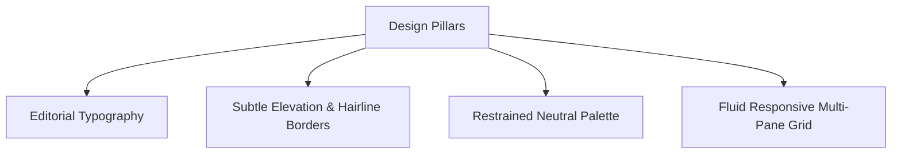
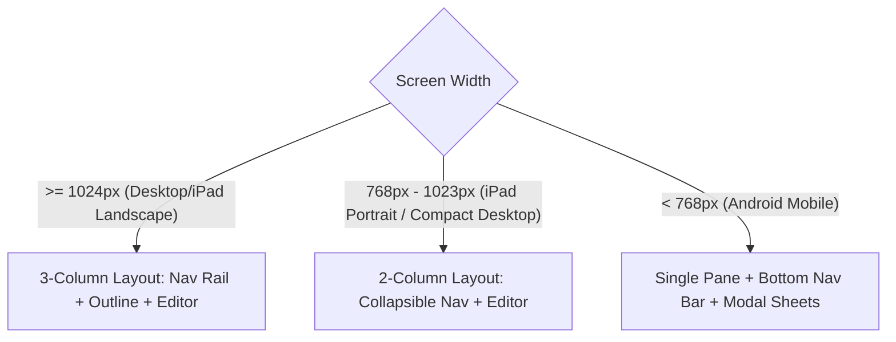

# ATLAS — Design System Specification

## 1. Design Philosophy: "Quiet Craft"

ATLAS avoids generic Flutter template aesthetics (e.g. garish floating action buttons, loud primary color toolbars, standard Material 3 ripple overlays).

Instead, ATLAS adopts an aesthetic inspired by:
- **Craft:** Refined typography, balanced whitespace, delicate hairline borders, and tactile page surfaces.
- **Notion:** Structured block layouts, inline property chips, slash command menus, and database views.
- **Obsidian:** Multi-pane collapsible sidebars, dense knowledge hierarchies, and dark-mode elegance.
- **Goodnotes:** Realistic paper templates, tactile notebook spines, and clean vector ink reproduction.



---

## 2. Typography Hierarchy

ATLAS uses a high-legibility sans-serif font stack: **Inter** as the default cross-platform typeface, falling back gracefully to platform-native typefaces (**SF Pro** on iPadOS, **Cantarell** on Linux, **Roboto** on Android). Monospace font uses **JetBrains Mono** or **Fira Code**.

| Token Name | Font Size | Line Height | Weight | Letter Spacing | Use Case |
| :--- | :--- | :--- | :--- | :--- | :--- |
| `displayLarge` | 36 pt | 44 pt | Bold (700) | -0.025 em | Document hero titles |
| `displayMedium` | 28 pt | 34 pt | SemiBold (600) | -0.020 em | Page titles, H1 blocks |
| `headlineLarge` | 22 pt | 28 pt | SemiBold (600) | -0.015 em | H2 section headings |
| `headlineMedium` | 18 pt | 24 pt | Medium (500) | -0.010 em | H3 sub-headings |
| `bodyLarge` | 15 pt | 22 pt | Regular (400) | 0.000 em | Primary reading & editor body |
| `bodyMedium` | 13 pt | 18 pt | Regular (400) | +0.005 em | Sidebar items, task titles |
| `labelMedium` | 11 pt | 15 pt | Medium (500) | +0.020 em | Badges, property chips, dates |
| `code` | 13 pt | 19 pt | Regular (400) | 0.000 em | Code blocks, inline `backticks` |

---

## 3. Color Tokens & Semantic Palette

```mermaid
flowchart LR
    subgraph Light_Theme [Light Surface Spectrum]
        L0[Background: #FAFAFA] --> L1[Surface: #FFFFFF]
        L1 --> L2[Elevated: #F4F4F5]
        L2 --> LBord[Border: rgba(0,0,0,0.08)]
    end

    subgraph Dark_Theme [Dark Surface Spectrum]
        D0[Background: #0E0E10] --> D1[Surface: #18181B]
        D1 --> D2[Elevated: #27272A]
        D2 --> DBord[Border: rgba(255,255,255,0.08)]
    end
```

### Color Variables
```dart
abstract class AtlasColors {
  // Light Palette
  static const lightBg = Color(0xFFFAFAFA);
  static const lightSurface = Color(0xFFFFFFFF);
  static const lightElevated = Color(0xFFF4F4F5);
  static const lightBorder = Color(0x14000000); // 8% Black
  static const lightTextPrimary = Color(0xFF18181B);
  static const lightTextSecondary = Color(0xFF71717A);
  static const lightTextMuted = Color(0xFFA1A1AA);

  // Dark Palette (OLED-friendly charcoal, avoiding stark pure black eye strain)
  static const darkBg = Color(0xFF0E0E10);
  static const darkSurface = Color(0xFF18181B);
  static const darkElevated = Color(0xFF27272A);
  static const darkBorder = Color(0x1AFFFFFF); // 10% White
  static const darkTextPrimary = Color(0xFFF4F4F5);
  static const darkTextSecondary = Color(0xFFA1A1AA);
  static const darkTextMuted = Color(0xFF71717A);

  // Accent & Brand Colors
  static const accentBlue = Color(0xFF3B82F6);
  static const accentSage = Color(0xFF10B981);
  static const accentAmber = Color(0xFFF59E0B);
  static const accentRose = Color(0xFFF43F5E);
  static const accentPurple = Color(0xFF8B5CF6);

  // Priority Tokens
  static const priorityP1 = Color(0xFFEF4444); // Urgent & Important
  static const priorityP2 = Color(0xFFF97316); // High
  static const priorityP3 = Color(0xFF3B82F6); // Medium
  static const priorityP4 = Color(0xFF94A3B8); // Low
}
```

---

## 4. Adaptive Layout & Multi-Pane Navigation

ATLAS responds dynamically to device form factor and screen geometry:



### Layout Specifications:
1. **Desktop & iPad Landscape ($\ge 1024\text{ dp}$):**
   - **Column 1: Navigation Sidebar (`240dp - 280dp`):** Workspaces switcher, quick links (Dashboard, Notes, Notebooks, Tasks, Calendar, Habits), nested tree hierarchy.
   - **Column 2: List / Outline Pane (`300dp - 340dp`):** Note lists, task filter lists, notebook page thumbnails, backlink list.
   - **Column 3: Active Workspace View (Flex):** Document editor, handwriting canvas, or PDF viewer.
2. **iPad Portrait & Small Tablets (`768dp - 1023dp`):**
   - Navigation Sidebar collapses into an overlay drawer or persistent icon-only rail (`64dp`).
   - Main workspace takes remaining screen width.
3. **Android Mobile Phone ($< 768\text{ dp}$):**
   - Modern floating or docked bottom navigation bar with 4 primary destinations: Dashboard, Notes, Tasks, Search.
   - Notebooks open in full-screen reader view.

---

## 5. Signature Components

### 5.1 Command Palette (`Cmd+K` / `Ctrl+K`)
- Center-aligned modal dialog with subtle blur backdrop (`BackdropFilter`).
- Top input field with instant fuzzy search (`prefix`, `typo-tolerant`).
- Categorized action list: Recently Opened, Actions, Switch Workspace, Create Task, Create Notebook.
- Keyboard navigation: `Up/Down` arrow keys, `Enter` to execute, `Esc` to dismiss.

### 5.2 Contextual Floating Toolbars
- **Text Selection Toolbar:** Pill-shaped floating bar appearing over highlighted text: Bold, Italic, Strikethrough, Code, Link, Highlight, Heading style.
- **PencilKit Floating Palette (iPadOS):** Native Apple `PKToolPicker` docked to bottom or edge, supporting native tool switching.
- **Portable Ink Floating Toolbar (Linux):** Minimal pill bar: Pen, Fountain Pen, Highlighter, Eraser, Stroke Width slider (3 presets), Color Palette (8 curated swatches), Undo, Redo.

### 5.3 Digital Paper Canvas Aesthetics
- Subtle paper drop shadow on desktop / tablet canvas views (`box-shadow: 0 4px 20px rgba(0,0,0,0.06)`).
- Crisp vector rendering of grid styles (ruled lines, dots, 5mm grid, Cornell layout margin lines).
- Margin ruler and page number badge.

---

## 6. Keyboard Shortcuts Matrix (Desktop & iPad External Keyboard)

| Shortcut | Action | Scope |
| :--- | :--- | :--- |
| `Cmd/Ctrl + K` | Open Command Palette | Global |
| `Cmd/Ctrl + N` | Create New Note | Global |
| `Cmd/Ctrl + Shift + N` | Create New Notebook | Global |
| `Cmd/Ctrl + T` | Create New Task | Global |
| `Cmd/Ctrl + \` | Toggle Left Sidebar | Global |
| `Cmd/Ctrl + P` | Quick Page Switcher | Global |
| `Cmd/Ctrl + F` | In-Page Find / Search | Document & Canvas |
| `Cmd/Ctrl + Z` | Undo | Document & Canvas |
| `Cmd/Ctrl + Shift + Z` | Redo | Document & Canvas |
| `Cmd/Ctrl + B` | Bold Selection | Rich Text Editor |
| `Cmd/Ctrl + I` | Italic Selection | Rich Text Editor |
| `/` | Trigger Slash Menu | Rich Text Editor |
