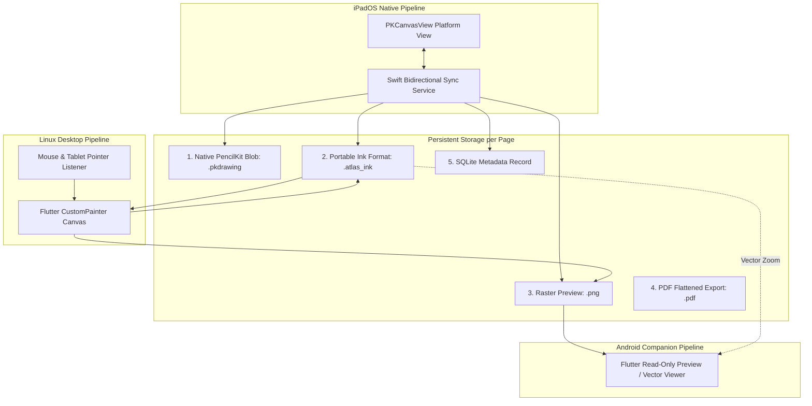
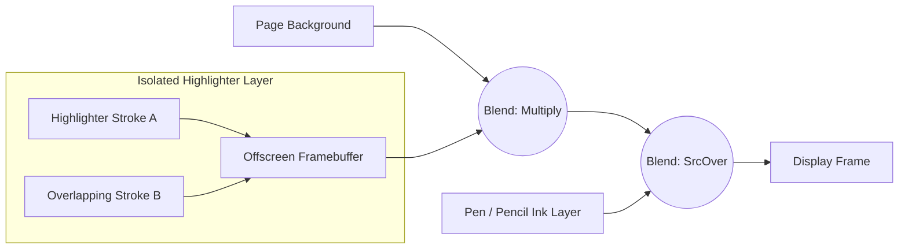

# ATLAS — Ink Engine & Handwriting Architecture

## 1. Architectural Overview & Design Goals

Handwriting is a core differentiator for ATLAS. The handwriting engine addresses a fundamental tension:
- **iPadOS** demands sub-10ms latency, native Apple Pencil features (pressure, tilt, roll, barrel tap/squeeze), and native palm rejection, which can only be achieved via Apple's hardware-accelerated **PencilKit** framework.
- **Linux** demands cross-platform vector fidelity, portable document inspection, and desktop stylus/mouse support.
- **Android** requires an efficient, read-only viewing pipeline that renders handwritten notes without carrying heavy stylus capture or palm-rejection overhead.

To resolve this, ATLAS adopts a **Dual-Engine / Unified Document Architecture**:



---

## 2. Portable Ink Document Format Specification (`.atlas_ink`)

The canonical cross-platform representation of handwriting in ATLAS is the **Atlas Portable Ink Document Format (PIF)**, stored with extension `.atlas_ink`.

### 2.1 File Structure (JSON Representation)

```json
{
  "version": 1,
  "generator": "atlas-ink-engine/1.0",
  "documentId": "4a7f0e32-9b21-4d3e-8c9f-3e110b543789",
  "pageNumber": 1,
  "dimensions": {
    "width": 1600.0,
    "height": 2200.0,
    "dpi": 264.0
  },
  "background": {
    "type": "dot_grid",
    "color": "0xFFFFFFFF",
    "gridSpacing": 28.35,
    "gridColor": "0xFFE0E0E0"
  },
  "layers": [
    {
      "id": "layer_background_highlights",
      "name": "Highlighter Layer",
      "visible": true,
      "opacity": 1.0,
      "blendMode": "multiply",
      "strokes": [
        {
          "id": "stroke_001",
          "tool": "highlighter",
          "color": "0x66FFEB3B",
          "baseWidth": 24.0,
          "opacity": 0.4,
          "blendMode": "multiply",
          "transform": [1.0, 0.0, 0.0, 1.0, 0.0, 0.0],
          "bounds": [120.0, 340.0, 480.0, 370.0],
          "points": [
            {
              "x": 120.5,
              "y": 355.0,
              "pressure": 0.5,
              "tiltAzimuth": 1.57,
              "tiltAltitude": 0.85,
              "timeOffsetMs": 0
            },
            {
              "x": 240.0,
              "y": 354.8,
              "pressure": 0.52,
              "tiltAzimuth": 1.57,
              "tiltAltitude": 0.85,
              "timeOffsetMs": 42
            }
          ]
        }
      ]
    },
    {
      "id": "layer_ink_main",
      "name": "Ink Layer",
      "visible": true,
      "opacity": 1.0,
      "blendMode": "srcOver",
      "strokes": [
        {
          "id": "stroke_002",
          "tool": "fountain_pen",
          "color": "0xFF1A237E",
          "baseWidth": 2.5,
          "opacity": 1.0,
          "blendMode": "srcOver",
          "transform": [1.0, 0.0, 0.0, 1.0, 0.0, 0.0],
          "bounds": [115.0, 320.0, 210.0, 395.0],
          "points": [
            {
              "x": 118.2,
              "y": 322.0,
              "pressure": 0.35,
              "tiltAzimuth": 2.10,
              "tiltAltitude": 0.78,
              "timeOffsetMs": 120
            }
          ]
        }
      ]
    }
  ],
  "metadata": {
    "createdAt": 1730912400000,
    "updatedAt": 1730912450000,
    "strokeCount": 2,
    "hasPencilKitSource": true
  }
}
```

### 2.2 Binary Packed Representation (`.atlas_ink_bin`)
For high-density drawings with over 10,000 points, JSON parsing overhead can exceed 50ms. ATLAS specifies an optional packed binary format:
- **Magic bytes:** `ATLASINK` (8 bytes)
- **Version:** `uint16` (2 bytes)
- **Flags & Layer Count:** `uint16` (2 bytes)
- **Document Dimensions:** 2x `float32` (8 bytes)
- **Stroke Table:**
  - `tool_type`: `uint8`
  - `color_argb`: `uint32`
  - `base_width`: `float32`
  - `point_count`: `uint32`
  - **Points Array (Packed Sequential Struct):**
    - `x`: `float32`
    - `y`: `float32`
    - `pressure`: `uint16` (normalized $0 \dots 65535$)
    - `tilt_azimuth`: `int16` (normalized $-\pi \dots \pi$)
    - `tilt_altitude`: `uint16` (normalized $0 \dots \pi/2$)
    - `time_delta_ms`: `uint16`

---

## 3. Mathematical Foundations & Curve Smoothing

Raw touch/stylus events arrive as discrete, jagged samples (typically 60Hz to 240Hz). The portable engine converts these into fluid, continuous vector curves.

### 3.1 Catmull-Rom to Cubic Bézier Spline Interpolation
Given four consecutive points $P_0, P_1, P_2, P_3$, the Catmull-Rom spline between $P_1$ and $P_2$ is transformed into an equivalent cubic Bézier curve with control points $C_1, C_2$:

$$C_1 = P_1 + \frac{P_2 - P_0}{6 \cdot \tau}$$

$$C_2 = P_2 - \frac{P_3 - P_1}{6 \cdot \tau}$$

where $\tau$ is the curve tension factor (default $\tau = 0.5$ for standard centripetal Catmull-Rom).

### 3.2 Pressure & Velocity Width Modulation
The dynamic stroke width $w(t)$ at any point is governed by the selected tool profile:

- **Ballpoint Pen:**
  $$w(p) = w_{\text{base}} \cdot (0.8 + 0.4 \cdot p)$$

- **Fountain Pen:**
  $$w(p, \theta) = w_{\text{base}} \cdot \left[ p_{\min} + (1 - p_{\min}) \cdot p^\gamma \right] \cdot \left[ 1 + \beta \cdot |\cos(\theta - \phi_{\text{pen}})| \right]$$
  where $p$ is normalized pressure ($0 \le p \le 1$), $\gamma = 1.6$ provides non-linear response, $\theta$ is stroke trajectory angle, and $\phi_{\text{pen}}$ is stylus azimuth angle.

- **Highlighter:**
  Constant width $w = w_{\text{base}}$, flattened chisel tip angle.

### 3.3 Highlighter Overlap & Multiply Compositing
In naive canvas renderers, overlapping highlighter strokes accumulate alpha, creating dark muddy intersections.
ATLAS solves this by rendering all highlighter strokes into an **isolated offscreen layer** with `BlendMode.srcOver`, and compositing that entire layer onto the page background using `BlendMode.multiply`.



---

## 4. iPadOS Native PencilKit Swift Bridge

On iPadOS, ATLAS hosts `PKCanvasView` inside a Flutter `UIKitView`.

### 4.1 Native Plugin Architecture (`AtlasPencilKitPlugin.swift`)
```swift
import Flutter
import UIKit
import PencilKit

public class AtlasPencilKitView: NSObject, FlutterPlatformView, PKCanvasViewDelegate {
    private var canvasView: PKCanvasView
    private var toolPicker: PKToolPicker?
    private var channel: FlutterMethodChannel
    
    init(frame: CGRect, viewId: Int64, messenger: FlutterBinaryMessenger, args: [String: Any]?) {
        self.canvasView = PKCanvasView(frame: frame)
        self.channel = FlutterMethodChannel(name: "com.atlas.pencilkit_\(viewId)", binaryMessenger: messenger)
        super.init()
        
        canvasView.delegate = self
        canvasView.drawingPolicy = .anyInput // Or .pencilOnly
        canvasView.backgroundColor = .clear
        
        if #available(iOS 14.0, *) {
            toolPicker = PKToolPicker()
            toolPicker?.setVisible(true, forFirstResponder: canvasView)
            toolPicker?.addObserver(canvasView)
            canvasView.becomeFirstResponder()
        }
        
        setupMethodChannel()
    }
    
    public func view() -> UIView {
        return canvasView
    }
    
    // Save operation: Extracts PKDrawing, converts to AtlasInkDocument, and exports PNG preview
    private func exportDrawing(result: @escaping FlutterResult) {
        let drawing = canvasView.drawing
        
        // 1. Raw PKDrawing binary data
        let pkData = drawing.dataRepresentation()
        
        // 2. High-res raster thumbnail
        let bounds = canvasView.bounds
        let image = drawing.image(from: bounds, scale: 2.0)
        let pngData = image.pngData()
        
        // 3. Transform PKStrokes into portable vector point arrays
        var portableStrokes: [[String: Any]] = []
        for stroke in drawing.strokes {
            var points: [[String: Any]] = []
            for pt in stroke.path {
                points.append([
                    "x": pt.location.x,
                    "y": pt.location.y,
                    "pressure": pt.force,
                    "tiltAzimuth": pt.azimuth,
                    "tiltAltitude": pt.altitude,
                    "timeOffsetMs": pt.timeOffset * 1000.0
                ])
            }
            portableStrokes.append([
                "tool": mapInkType(stroke.ink.inkType),
                "color": stroke.ink.color.toHexArgb(),
                "baseWidth": stroke.ink.weight,
                "points": points
            ])
        }
        
        result([
            "pkDrawingBytes": FlutterStandardTypedData(bytes: pkData),
            "pngPreviewBytes": FlutterStandardTypedData(bytes: pngData ?? Data()),
            "portableStrokes": portableStrokes
        ])
    }
}
```

---

## 5. Linux & Android Portable Ink Pipeline

### 5.1 Android Read-Only Viewer Strategy
- Android does **not** capture or edit handwriting.
- Page viewing loads the cached `preview_png_hash` image instantly through an optimized texture-backed image widget.
- If the user pinch-zooms beyond 2.0x magnification, the viewer activates the Dart vector `CustomPainter` to render sharp, lossless vector curves at any zoom factor.

### 5.2 Linux Desktop Renderer & Optional Editor
- Linux uses a Dart `CustomPainter` backed by a `ui.PictureRecorder` caching strategy.
- Repaint Boundaries isolate static committed strokes from active ongoing strokes, preventing re-rendering of thousands of historical points during input.
- Input events from USB graphic tablets (Wacom, XP-Pen, Huion) receive pressure values directly through Flutter's `PointerEvent.pressure`.

---

## 6. Milestone 2 Implementation Verification & Reused Packages

Following the mandatory software reuse directive, ATLAS evaluated existing open-source libraries before implementation (see [INK_PACKAGE_AUDIT.md](INK_PACKAGE_AUDIT.md)):

### 6.1 Adopted Reused Packages
1. **`perfect_freehand` (v2.5.2+1, MIT)**:
   - High-performance, pure Dart stroke outline generator adapting Dave Rupert / Steve Ruiz's polygon tessellation algorithm.
   - Eliminates thousands of lines of fragile custom spline math.
   - Adapted in [`StrokeTessellator`](../lib/features/handwriting/domain/math/stroke_tessellator.dart) with specific taper, streamline, smoothing, and thinning profiles for Ballpoint Pen, Fountain Pen, Highlighter, and Pencil.
2. **`pencil_kit` (v2.1.1, MIT)**:
   - Flutter plugin providing `UiKitView` embedding of native iOS `PKCanvasView`.
   - Wrapped behind ATLAS abstraction [`PencilKitBridge`](../lib/features/handwriting/presentation/platform/pencil_kit_bridge.dart) and [`AtlasPencilKitPlugin.swift`](../ios/Runner/PencilKit/AtlasPencilKitPlugin.swift).

### 6.2 Component Matrix
| Component | Class | Path | Description |
| :--- | :--- | :--- | :--- |
| **Domain Models** | `AtlasInkDocument` | `lib/features/handwriting/domain/models/` | Immutable, multi-layer ink document model |
| **Tessellator** | `StrokeTessellator` | `lib/features/handwriting/domain/math/` | Adapts `perfect_freehand` to quadratic Bézier `Path` |
| **Serialization** | `InkJsonSerializer` / `InkBinarySerializer` | `lib/features/handwriting/data/serializers/` | Dual JSON and packed binary (`ATLASINK` magic) formats |
| **Repository** | `InkRepository` | `lib/features/handwriting/data/repositories/` | Coordinates `InkDao` SQLite records and CAS blob files |
| **Canvas** | `InkCanvas` | `lib/features/handwriting/presentation/widgets/` | Interactive pointer listener with pressure support |
| **Painter** | `InkDocumentPainter` | `lib/features/handwriting/presentation/widgets/` | Paper templates + multiply-composited highlighters |
| **Companion Viewer**| `InkPageView` | `lib/features/handwriting/presentation/widgets/` | Read-only zoom/pan viewer for Android & preview mode |
| **Tool Palette** | `InkToolPalette` | `lib/features/handwriting/presentation/widgets/` | Floating pill with tools, widths, colors, undo/redo |
| **Screen** | `NotebookEditorScreen` | `lib/features/handwriting/presentation/screens/` | Full multi-page editor with autosave |

---

## 7. Milestone 2.1: Native PencilKit Mounting & Bidirectional Interoperability

Milestone 2.1 addresses the findings of the independent M2 Technical Verification Audit, completing the production bridge between native Apple PencilKit and the cross-platform ATLAS Portable Ink Engine.

### 7.1 Native iPadOS PencilKit Mounting (`NotebookEditorScreen`)
On iPadOS (`defaultTargetPlatform == TargetPlatform.iOS`), `NotebookEditorScreen` conditionally mounts the native `PencilKit` widget (`package:pencil_kit/pencil_kit.dart`) inside an adaptive stationery container matching document dimensions (e.g. 1600x2200):
- **Visual Parity:** Underlying `CustomPaint` with `PaperPatternPainter` renders paper templates (ruled, dotted, square grid, blank) beneath a transparent `PKCanvasView`.
- **Rehydration Safety:** Re-hydrates from raw Apple `.pkdrawing` binaries stored in CAS (`page.rawPencilkitHash`) for 100% lossless fidelity, or reconstructs `PKDrawing` from portable ink if created on Linux desktop.
- **Initialization Guard:** Blocks modification flags until the initial drawing is fully loaded into `PKCanvasView`, guaranteeing opening an existing drawing never overwrites it with a blank canvas.

### 7.2 Swift Bidirectional Reconstruction Layer (`AtlasPencilKitPlugin.swift` & `PencilKitConverter.dart`)
ATLAS implements full bidirectional translation between Apple `PKDrawing` and `.atlas_ink`:
1. **Portable Ink -> PencilKit Reconstruction (`constructDrawing`):**
   - Synthesizes `PKStrokePoint` objects from portable ink points, mapping coordinates `(x, y)`, normalized force `pressure.clamp(0.01, 1.0)`, `tiltAzimuth`, `tiltAltitude`, and millisecond `timeOffset`.
   - **Single-Point Dot Handling:** Generates an offset point ($+0.1$ px, $+0.001$ s) for single-point taps to prevent `PKStrokePath` from discarding standalone punctuation or dots.
   - **Tool & Color Mapping:** Maps ballpoint pen, fountain pen, pencil, and highlighter to Apple `PKInk.InkType` (.pen, .pencil, .marker) and converts 32-bit ARGB values to `UIColor`. Unsupported or newer iOS 17+ tools fall back gracefully to `PKInk.InkType.pen`.
2. **PencilKit -> Portable Ink Extraction (`extractPortableStrokes`):**
   - Extracts raw `PKStroke` control points, force, and tilt telemetry into portable stroke dictionaries.
   - Separates highlighter strokes into dedicated multiply-composited layers (`layer_highlighter`).

### 7.3 Autosave & Back-Navigation Data Loss Prevention (P3)
To eliminate data loss on screen exit:
- **Mutex & Queue:** `_flushPendingSaves()` coordinates with in-flight autosaves via a `Completer<bool>` mutex.
- **Route Interception (`PopScope`):** `PopScope(canPop: !_hasUnsavedChanges && !_isSaving)` intercepts system back gestures, swipes, and the AppBar back button, flushing pending changes before popping.
- **Failure Resilience:** If CAS disk or database persistence fails, the unsaved state remains active (`_hasUnsavedChanges = true`), a persistent SnackBar alerts the user with a Retry affordance, and navigation is aborted.
