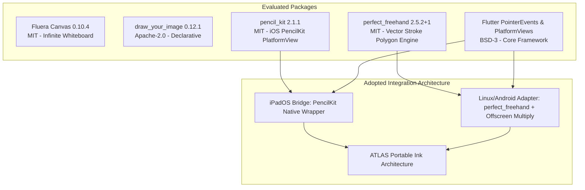

# ATLAS — Ink Engine Package Audit & Reuse Evaluation

## 1. Executive Summary

In accordance with the **Reuse Existing Software** directive, candidate open-source drawing, digital ink, and canvas packages were audited against the technical, performance, and legal requirements of ATLAS:

- **Target Platforms:** iPadOS (native Apple Pencil via PencilKit), Linux desktop (vector rendering, zoom/pan, mouse/tablet editing), Android (read-only vector and raster preview viewer).
- **Core Requirement:** Sub-10ms hardware latency on iPadOS, portable cross-platform vector fidelity (`.atlas_ink`), pressure and tilt handling, non-muddy highlighter compositing, and ACID-backed persistence.

---

## 2. Candidate Evaluation Matrix

| Criterion | `fluera_canvas` (0.10.4) | `draw_your_image` (0.12.1) | `pencil_kit` (2.1.1) | `perfect_freehand` (2.5.2+1) | Flutter Native Input APIs |
| :--- | :--- | :--- | :--- | :--- | :--- |
| **License** | MIT | Apache-2.0 | MIT | MIT | BSD-3-Clause |
| **Commercial Safe?** | Yes | Yes | Yes | Yes | Yes |
| **Maintenance** | Active (2025/2026) | Moderate | Active | Highly Active | Maintained by Google |
| **iPadOS Support** | Pure Dart Canvas | Pure Dart Canvas | **Native PKCanvasView** | Pure Dart Math | Native Framework |
| **Linux Support** | Yes (Desktop) | Yes | **No (iOS only)** | Yes (Desktop) | Native |
| **Android Read-Only** | Yes | Yes | **No (iOS only)** | Yes | Native |
| **Apple Pencil Hardware** | Simulated in Dart | Simulated in Dart | **Hardware-native (<10ms)**| Pure math (accepts pressure) | Low-level pointer events |
| **Pressure & Tilt** | Basic pressure | Device-kind only | **Full native hardware** | **Full pressure & tilt** | Direct access (`PointerEvent`) |
| **Palm Rejection** | Basic touch filter | Discard touch | **Apple Native Hardware** | N/A (algorithm only) | Native |
| **Highlighter Multiply**| No (accumulates) | No (accumulates) | **Native PencilKit** | Custom shader/blend mode | `BlendMode.multiply` layer |
| **Document Paradigm** | Infinite whiteboard | Canvas snippet | Document drawing | Independent stroke curve | Raw canvas |
| **Serialization** | JSON scene graph | Points array | PKDrawing binary / PNG | Normalized vector points | N/A |
| **Verdict** | **Reject for notebook core** | **Reject for notebook core**| **ADOPT (iOS Bridge base)** | **ADOPT (Stroke Engine base)**| **ADOPT (Platform views & input)**|

---

## 3. In-Depth Candidate Audits

### 3.1 Candidate A: `fluera_canvas` (`Lorencoshametaj/fluera_canvas`)
- **Package:** `fluera_canvas: ^0.10.4`
- **License:** MIT License.
- **Architecture:** Infinite 2D scene graph engine with spatial indexing (R-tree/grid culling), camera matrix tracking (pan, zoom, rotate), and multi-layer rendering.
- **Strengths:**
  - Excellent pan, zoom, and spatial culling for thousands of elements.
  - Built-in undo/redo and layer management.
  - Pure Dart; runs across Linux, macOS, Windows, Android, and iOS.
- **Critical Limitations for ATLAS:**
  - **Whiteboard vs. Notebook Paradigm Mismatch:** `fluera_canvas` is modeled around infinite unconstrained whiteboards. ATLAS notebooks use fixed-dimension pages (e.g. 1600x2200 US Letter / A4) with page margins, rule lines, and page flipping.
  - **Commercial Paywall for Notability Brushes:** The open-source core provides basic line drawing. Realistic ink brushes, GPU rendering, and vector export are locked behind proprietary commercial add-ons (`fluera_canvas_gpu`, `fluera_engine_pro`).
  - **No PencilKit Integration:** Completely bypasses native iOS PencilKit, resulting in 30ms+ latency on iPadOS rather than the required sub-10ms Apple hardware pipeline.
- **Recommendation:** **Do NOT adopt as the primary notebook engine.** Study its spatial viewport culling concepts for future infinite canvas modes, but do not couple ATLAS fixed-page notebooks to it.

---

### 3.2 Candidate B: `draw_your_image` (`draw_your_image: ^0.12.1`)
- **Package:** `draw_your_image: ^0.12.1`
- **License:** Apache 2.0.
- **Architecture:** Declarative Flutter widget (`Draw`) that accepts `List<Stroke>` and triggers `onStrokeDrawn`.
- **Strengths:**
  - Declarative API structure.
  - Differentiates `PointerDeviceKind.stylus`, `touch`, and `mouse`.
  - Built-in Catmull-Rom smoothing.
- **Critical Limitations for ATLAS:**
  - No pressure or tilt values preserved in its public stroke model.
  - Lacks zoom/pan viewport navigation, multi-layer compositing, and eraser masking.
  - Re-renders all strokes on every frame without texture caching, causing severe frame drops once stroke count exceeds 200.
- **Recommendation:** **REJECT.** Too primitive for production-grade handwritten notebooks.

---

### 3.3 Candidate C: `pencil_kit` (`mj-studio-library/flutter-pencilkit`)
- **Package:** `pencil_kit: ^2.1.1`
- **License:** MIT License.
- **Architecture:** iOS platform view (`UiKitView`) wrapping Apple's native `PKCanvasView` and `PKToolPicker`.
- **Strengths:**
  - Delivers sub-10ms latency using Apple's native Metal pipeline.
  - Full Apple Pencil pressure, tilt, roll, and barrel tap/squeeze hardware integration.
  - Apple native palm rejection and undo/redo.
  - Supports `getBase64PngData()` for raster preview export and `PKDrawing` binary saving.
- **Critical Limitations & Gaps:**
  - Only runs on iOS; crashes or displays red warning boxes on Linux and Android if rendered directly.
  - Public Dart API does **not** expose individual stroke points (`PKStrokePoint.location`, `force`, `azimuth`, `altitude`), which is required for export to the ATLAS portable vector format (`.atlas_ink`).
- **Recommendation:** **ADOPT and EXTEND for iPadOS.**
  - Use its proven `UiKitView` platform view and tool picker lifecycle patterns.
  - Extend the native Swift MethodChannel (`AtlasPencilKitPlugin`) to extract vector `PKStroke` and `PKStrokePoint` collections during save/export.

---

### 3.4 Candidate D: `perfect_freehand` (`steveruizok/perfect-freehand-dart`)
- **Package:** `perfect_freehand: ^2.5.2+1`
- **License:** MIT License (created by Steve Ruiz, author of tldraw).
- **Architecture:** Mathematical stroke tessellation library that converts an array of discrete points `(x, y, pressure)` into a smooth, closed variable-width polygon outline.
- **Strengths:**
  - **Industry Standard:** Powering tldraw and trusted by millions of users worldwide.
  - **Variable-Width Physics:** Accurately models pen pressure, stroke velocity, start/end tapering, and corner rounding.
  - **Pure Dart & Zero Native Overhead:** Compiles effortlessly on Linux, Android, iOS, Windows, macOS, and Web.
  - **High Performance:** Capable of generating vector outlines for hundreds of points in under 0.2ms.
  - **Platform-Independent:** Renders into standard Flutter `Path` objects suitable for both vector display and raster caching.
- **Recommendation:** **ADOPT as the core vector stroke engine for Linux editing and Android/Linux portable rendering.**

---

### 3.5 Candidate E: Flutter Native Input & Canvas APIs
- **`Listener` & `PointerEvent`:** Direct access to `PointerDeviceKind.stylus`, `PointerEvent.pressure`, `PointerEvent.tilt`, and `PointerEvent.orientation` on Linux desktop graphics tablets (Wacom, Huion, XP-Pen).
- **`PictureRecorder` & `RepaintBoundary`:** Allows baking committed historical strokes into immutable `ui.Picture` textures, eliminating CPU recalculation during active drawing.
- **`BlendMode.multiply`:** Solves the digital highlighter overlap problem by rendering highlighters in an offscreen layer before compositing onto the page.

---

## 4. Final Package Adoption Decision

| Responsibility | Selected Package / Solution | License | Rationale |
| :--- | :--- | :--- | :--- |
| **Vector Stroke Polygon Math** | **`perfect_freehand` (2.5.2+1)** | MIT | Mature, production-tested algorithm for variable-width pressure curves; eliminates need to write custom spline math. |
| **iPadOS Native Drawing** | **`pencil_kit` (2.1.1) + Custom Swift Bridge** | MIT | Native Apple `PKCanvasView` provides sub-10ms latency and hardware palm rejection on iPadOS. |
| **Desktop Linux Input** | **Flutter Native `PointerEvent` API** | BSD-3 | Native USB graphics tablet pressure & tilt capture. |
| **Rendering & Caching** | **`CustomPainter` + `ui.PictureRecorder`** | BSD-3 | Texture-backed caching isolates historical strokes from in-flight input, maintaining 60fps/120fps. |
| **Portable Document Model** | **ATLAS-Owned `.atlas_ink` Engine** | ATLAS Core | Open, versioned JSON and binary packed format bridging PencilKit and Dart vector rendering. |

