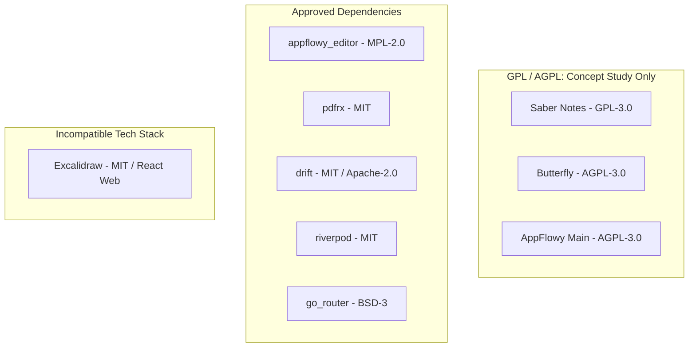

# ATLAS — Open-Source Audit & Licensing Assessment

## 1. Executive Summary & Legal Policy

ATLAS evaluates candidate open-source software against three strict criteria:
1. **License Safety:** Prevention of unintended copyleft infection (GPL/AGPL).
2. **Architectural Cohesion:** Prevention of monolithic bloat, unmaintainable native bindings, or runtime fragility.
3. **Cross-Platform Compatibility:** Verified stability on iPadOS, Linux desktop, and Android.

### Licensing Policy
- **GPL-3.0 / AGPL-3.0 Projects (Saber, Butterfly, AppFlowy Core):**
  - **Verdict:** **Zero code copying.** No source files, snippets, or private libraries may be copied or compiled into ATLAS.
  - **Permitted Use:** Clean-room study of mathematical formulas (e.g., Catmull-Rom spline algorithms, highlighter layer compositing) and interaction paradigms.
- **MPL-2.0 Projects (`appflowy_editor`):**
  - **Verdict:** **Permitted as an external dependency.** MPL-2.0 is a file-level copyleft license; consuming the package does not copyleft the consuming application, provided any direct edits to the package source itself remain open under MPL-2.0.
- **MIT / Apache-2.0 / BSD Projects (`pdfrx`, `drift`, `riverpod`, `go_router`):**
  - **Verdict:** **Fully approved for integration and distribution**, subject to standard copyright attribution in the app's `NOTICE` file.

---

## 2. Detailed Candidate Evaluations

---

### 2.1 Saber Notes (`saber-notes/saber`)
- **Repository:** `https://github.com/saber-notes/saber`
- **License:** **GNU General Public License v3.0 (GPL-3.0)**
- **Maintenance Activity:** Highly active community, frequent releases on F-Droid and Play Store.
- **Platform Support:** Linux, Android, iOS, Windows, macOS, Web.
- **Strengths & Reusable Ideas:**
  - Excellent highlighter compositing logic (renders highlighters in a separate layer to avoid dark overlapping intersections).
  - Smart Dark Mode inversion algorithm (inverts backgrounds while preserving ink hue semantics).
  - Multi-tier nested folder structure.
- **Architectural Limitations:**
  - Uses custom `.sba` zip-based file archives rather than a centralized relational database, limiting cross-entity graph queries.
  - Tightly coupled custom canvas state that does not leverage Apple's native PencilKit on iPadOS.
- **Licensing Risk:** **HIGH (Viral Copyleft).** Copying any code from Saber forces ATLAS to become GPL-3.0.
- **Recommendation:** **Clean-room architectural reference only.** Study the mathematical concepts of its highlighter compositing and inverted dark mode, but write clean, independent implementations.

---

### 2.2 Butterfly (`LinwoodDev/Butterfly`)
- **Repository:** `https://github.com/LinwoodDev/Butterfly`
- **License:** **GNU Affero General Public License v3.0 (AGPL-3.0)** (Core) / Apache-2.0 (API) / CC-BY-SA-4.0 (Assets).
- **Maintenance Activity:** Maintained by Linwood Dev.
- **Platform Support:** Android, Linux, Windows, macOS, Web.
- **Strengths & Reusable Ideas:**
  - Infinite canvas navigation and viewport transformations (matrix transformation).
  - Tool palette layout and waypoint system.
- **Architectural Limitations:**
  - Infinite canvas model conflicts with ATLAS's fixed-page digital notebook paradigm (Goodnotes/Craft style).
  - High complexity in rendering loops; noticeable latency on high-density drawings.
- **Licensing Risk:** **CRITICAL (AGPL-3.0).** Strongest copyleft in existence; network interaction triggers copyleft source disclosure obligations.
- **Recommendation:** **Reject for code reuse.** Clean-room reference for UI controls only.

---

### 2.3 AppFlowy Core (`AppFlowy-IO/AppFlowy`)
- **Repository:** `https://github.com/AppFlowy-IO/AppFlowy`
- **License:** **GNU Affero General Public License v3.0 (AGPL-3.0)**
- **Maintenance Activity:** Exceptionally active corporate-backed open-source project.
- **Platform Support:** Linux, macOS, Windows, iOS, Android.
- **Architecture:** Monolithic hybrid consisting of a Flutter frontend communicating via FFI with `appflowy-core` (a large Rust backend handling SQLite, CRDTs, and synchronization).
- **Architectural Limitations for ATLAS:**
  - Extreme integration complexity: Requires cross-compiling Rust crates for all target architectures (Linux x86_64, iOS arm64, Android aarch64/armv7).
  - Heavy binary overhead (~40-80MB additional binary size).
  - Custom data store is tightly coupled to AppFlowy's proprietary cloud synchronization protocols.
- **Licensing Risk:** **CRITICAL (AGPL-3.0).** Copying any Rust or Dart core code infects ATLAS.
- **Recommendation:** **Do NOT integrate AppFlowy core.** ATLAS will use a pure Dart + Drift (SQLite) architecture that is lightweight, transparent, and compile-ready on standard Flutter SDKs.

---

### 2.4 AppFlowy Editor (`appflowy_editor`)
- **Repository:** `https://github.com/AppFlowy-IO/appflowy-editor`
- **Package:** `pub.dev/packages/appflowy_editor`
- **License:** **Dual Licensed: Mozilla Public License 2.0 (MPL-2.0) / AGPL-3.0**
- **Maintenance Activity:** Very active; core sub-project decoupled from AppFlowy's Rust engine. Pure Flutter/Dart.
- **Platform Support:** Linux, macOS, Windows, iOS, Android, Web.
- **Strengths:**
  - Block-based document model (Notion-style nodes).
  - Native `/` slash menu support, markdown shortcuts, customizable node renderers.
  - Rich text formatting: headings, lists, checklists, quotes, code blocks.
  - High test coverage and pure Dart implementation with zero native binary dependencies.
- **Licensing Analysis (MPL-2.0):**
  - Under MPL-2.0 terms, consuming `appflowy_editor` as a package dependency does **not** infect the proprietary or commercial host application.
  - Any direct modifications made to files within `appflowy_editor` must remain under MPL-2.0.
- **Recommendation:** **ADOPT as the primary rich-text block editing engine.**

---

### 2.5 Excalidraw (`excalidraw/excalidraw`)
- **Repository:** `https://github.com/excalidraw/excalidraw`
- **License:** **MIT License**
- **Tech Stack:** TypeScript, React, HTML5 Canvas.
- **Evaluation:**
  - While Excalidraw's hand-drawn aesthetic (Rough.js) is renowned, it is a web-only JavaScript application.
  - Running Excalidraw inside Flutter requires embedding a web view (`flutter_inappwebview`), resulting in high memory usage, battery drain, poor Apple Pencil latency (30-60ms webview input lag), and fragile offline file bridging.
- **Recommendation:** **REJECT as canvas engine.** Vector aesthetics and JSON schema can be studied, but canvas rendering must remain native Flutter / PencilKit.

---

### 2.6 `pdfrx` (`pub.dev/packages/pdfrx`)
- **Repository:** `https://github.com/espresso3389/pdfrx`
- **License:** **MIT License**
- **Platform Support:** iOS, Android, Linux, macOS, Windows, Web (via PDFium).
- **Strengths:**
  - Modern, fast, and actively maintained.
  - Built on Google's native PDFium engine.
  - Supports zoom, page rendering, text selection, and multi-layer overlays.
- **Recommendation:** **ADOPT for PDF viewing and annotation support.**

---

### 2.7 `drift` & `sqlite3_flutter_libs`
- **License:** **MIT / Apache-2.0**
- **Platform Support:** Linux, iOS, Android, macOS, Windows, Web.
- **Strengths:** Compile-time verified SQL queries, reactive streams, full SQLite FTS5 support, automated migrations.
- **Recommendation:** **ADOPT as core relational database engine.**

---

### 2.8 Native PencilKit Integration
- **License:** Apple Proprietary SDK (Standard iOS SDK Terms).
- **Plugin Approach:** Build a lightweight custom native plugin (`AtlasPencilKitPlugin`) using Swift and Flutter `PlatformView` (`UIKitView`).
- **Recommendation:** **ADOPT for iPadOS.**

---

## 3. Attribution & Compliance Tracking Matrix

| Library / Tool | Intended Use | License | Attribution File Required? |
| :--- | :--- | :--- | :--- |
| `appflowy_editor` | Block Document Editor | MPL-2.0 | Yes (`NOTICE.md` + MPL disclosure) |
| `pdfrx` | PDF Viewer | MIT | Yes (`NOTICE.md`) |
| `drift` / `sqlite3` | SQLite ORM | MIT | Yes (`NOTICE.md`) |
| `flutter_riverpod` | State Management | MIT | Yes (`NOTICE.md`) |
| `go_router` | Declarative Routing | BSD-3 | Yes (`NOTICE.md`) |
| `freezed` | Value Objects | MIT | Build-time only |
