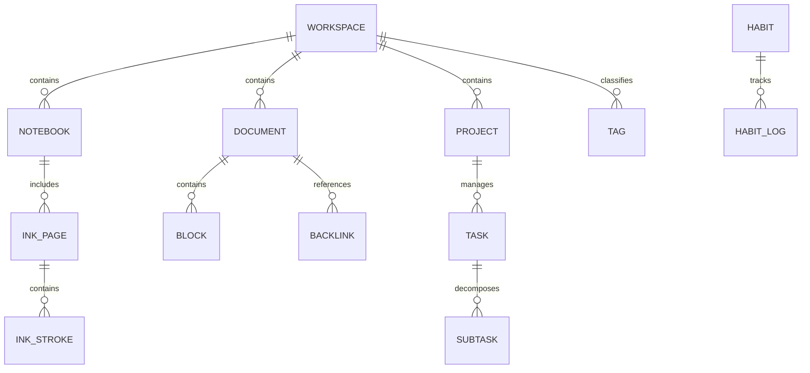

# ATLAS — Product Specification

## 1. Product Vision & Value Proposition

**ATLAS** is a unified personal knowledge, productivity, and handwriting operating system designed for serious knowledge workers, researchers, engineers, and creators. 

Modern productivity workflows are fractured across specialized tools:
- **Notion** provides modular databases, properties, and relation management.
- **Obsidian** provides local Markdown autonomy, bi-directional backlinks, and knowledge graphs.
- **Craft** provides bespoke visual elegance, responsive typography, and document structure.
- **Goodnotes** provides low-latency digital handwritten notebooks and PDF markup.
- **OneNote** provides mixed spatial organization combining text and ink.
- **Todoist** provides structured task tracking, priority workflows, and planning.

ATLAS fuses these capabilities into a single, cohesive, local-first system where every entity—a handwritten notebook page, a block of rich text, a project milestone, a task, or a PDF annotation—participates in a single knowledge graph and unified SQLite database.

---

## 2. Platform Architecture & Tier Strategy

ATLAS targets three distinct operating systems with tailored user interaction profiles:

```mermaid
graph TD
    A[ATLAS Workspace] --> B[iPadOS: Tier 1 Primary Handwriting]
    A --> C[Linux: Full Desktop Powerhouse]
    A --> D[Android: Productivity Companion]

    B --> B1[Apple Pencil + PencilKit]
    B --> B2[Sub-10ms Hardware Latency]
    B --> B3[Native Pressure, Tilt & Palm Rejection]
    B --> B4[PDF Annotation & Notebooks]
    B --> B5[Full Knowledge & Task Suite]

    C --> C1[Full Document & Block Editing]
    C --> C2[Portable Ink Engine: Render & Edit]
    C --> C3[Knowledge Graph & FTS5 Search]
    C --> C4[Keyboard-First Command Palette]
    C --> C5[Mouse / Graphics Tablet Input]

    D --> D1[Pure Typed Notes & Block Editing]
    D --> D2[Read-Only Ink Notebook Viewer]
    D --> D3[Tasks, Subtasks & Reminders]
    D --> D4[Daily Journal & Habit Tracker]
    D --> D5[Zero Stylus / Drawing Overhead]
```



### 2.1 iPadOS — Full Experience (Primary Handwriting Platform)
- **Role:** High-fidelity capture, handwriting notebook creation, deep study, PDF reading and markup, full knowledge editing.
- **PencilKit Integration:**
  - Direct integration with native iOS `PencilKit` via Swift `UIKitView` platform view.
  - Sub-10ms drawing latency leveraging Apple's native hardware-accelerated Metal pipeline.
  - Full support for Apple Pencil hardware features: variable pressure, azimuth (tilt angle), altitude, roll, double-tap tool switching, and squeeze interactions.
  - Complete native palm rejection and finger-versus-stylus disambiguation.
- **Capabilities:**
  - Multi-notebook and multi-page handwritten notebooks with configurable paper templates (dot, grid, ruled, Cornell, blank).
  - High-performance PDF rendering and multi-layer vector ink annotations.
  - Block-based rich-text editing with embedded handwriting canvases.
  - Full task, project, calendar, and knowledge graph capabilities.

### 2.2 Linux — Full Desktop Experience
- **Role:** Desktop productivity hub, long-form writing, deep research, knowledge graph analysis, keyboard-centric task management.
- **Handwriting Capabilities:**
  - Viewing of handwritten notes created on iPadOS via high-resolution raster previews and vector rendering.
  - Native Flutter/Dart vector ink engine rendering portable ink documents (`.atlas_ink`).
  - Desktop-grade mouse and USB graphics tablet (Wacom, Huion, etc.) input support for annotations and sketching.
- **Desktop Capabilities:**
  - Multi-pane, 3-column responsive layout (Navigation, List/Outline, Document/Canvas).
  - Global Command Palette (`Ctrl+K`) for lightning-fast command execution and entity switching.
  - Full-Text Search (FTS5) with sub-millisecond query results across notes, tasks, and tags.
  - Interactive 2D knowledge graph visualization with force-directed physics.
  - Local file management, Markdown import/export, and offline SQLite storage.

### 2.3 Android — Productivity Companion
- **Role:** Mobile capture, task execution, schedule management, reference reading, habit tracking.
- **Handwriting Policy (Explicit Requirement):**
  - **Zero handwriting creation or stylus input.**
  - No stylus driver integration, drawing canvas tools, pressure sensitivity, or palm rejection code.
  - **Read-Only Rendering:** Displays handwritten notebook pages and PDF annotations created on iPadOS using either generated high-res PNG previews or the read-only Flutter Portable Ink vector renderer.
- **Companion Capabilities:**
  - Create, edit, and organize typed notes and rich-text blocks.
  - Task management: create tasks, complete subtasks, set priorities, view upcoming agendas.
  - Daily journal entries, habit tracking, and review logs.
  - Instant offline access to synchronized SQLite database and local attachments.
  - Full-text search and backlink navigation.

---

## 3. Detailed Functional Modules



### 3.1 Notebooks & Handwriting Engine
- **Notebook Hierarchy:** Workspaces > Notebooks > Chapters/Sections > Pages.
- **Paper Geometry & Templates:**
  - Dynamic aspect ratios (US Letter, A4, Infinite vertical, Custom).
  - Paper templates: Dot grid (5mm), Ruled (college/wide), Square grid, Cornell notes, Blank, Isometric.
  - Smart Dark Mode: Invert paper background and ink colors dynamically based on UI theme while preserving color semantics (e.g. red ink remains visible).
- **Ink Tools:**
  - Ballpoint Pen (constant width, pressure-modulated velocity).
  - Fountain Pen (pressure-sensitive width, tilt-sensitive shading).
  - Highlighter (semi-transparent, composited with multiply blend mode behind text).
  - Vector Eraser (stroke-by-stroke deletion) and Pixel Eraser (masking/cutting).
  - Lasso Tool (select, move, resize, rotate, copy, delete strokes).
  - Shape Recognition (straight lines, rectangles, circles, arrows).

### 3.2 Rich-Text Document Engine
- **Block-Based Architecture:**
  - Block primitives: Paragraph, Headings (H1-H6), Bulleted List, Numbered List, Toggle List, Checklist, Code Block (with syntax highlighting), Callout, Blockquote, Divider, Table.
  - Slash command menu (`/`) for rapid block insertion.
  - Markdown shortcuts (e.g., `# `, `- [ ] `, `> `, ` ``` `).
  - Embedded blocks: Inline handwriting canvas, PDF preview, image, task list, database view.
- **Bi-Directional Linking & Knowledge Graph:**
  - `[[Page Title]]` auto-complete syntax for linking entities.
  - Backlinks pane showing referencing documents and context snippets.
  - Interactive force-directed knowledge graph with node filtering by tag, folder, and date.

### 3.3 Tasks, Projects & Planning
- **Task Entities:**
  - Status: `todo`, `in_progress`, `completed`, `cancelled`.
  - Priority: `P1` (Urgent & Important), `P2` (Important), `P3` (Urgent), `P4` (Normal).
  - Due Dates & Recurring Schedules: Daily, weekly, monthly, custom RRULE patterns.
  - Hierarchical subtasks with progress tracking.
- **Contextual Task Association:**
  - Tasks can exist independently or be embedded within notebook pages or documents.
  - Bi-directional association: A task links back to its parent document block.
- **Views:**
  - List View, Board/Kanban View (by status/priority), Agenda/Calendar View.

### 3.4 Calendar, Journal, Habits & Goals
- **Daily Journal:**
  - Auto-generated daily note with customizable templates (morning intentions, daily tasks, evening reflections).
  - Timeline view displaying time-blocked tasks and calendar events.
- **Habits & Goals:**
  - Habit tracker with streak counting, completion frequency, and heatmaps.
  - Goals system linking high-level objectives to projects and measurable key results.

### 3.5 PDF Viewer & Markup Engine
- **PDF Core:** High-performance PDFium-based rendering (`pdfrx`).
- **Layered Markup:**
  - Original PDF remains unmodified.
  - Vector ink layer sits above the PDF viewport, mapped to document coordinate space.
  - Export capability: Flatten ink annotations onto the source PDF to generate standardized PDF documents for external sharing.

### 3.6 Search & Command Palette
- **SQLite FTS5 Full-Text Engine:**
  - Real-time indexing of note text, task titles, tags, and OCR-extracted ink text.
  - Prefix matching, boolean operators (`AND`, `OR`, `NOT`), and BM25 relevance ranking.
- **Command Palette (`Cmd/Ctrl+K`):**
  - Universal modal interface for navigation, entity creation, search, and action dispatch.

---

## 4. Non-Functional Requirements & Performance Budgets

| Metric | Target Budget | Verification Strategy |
| :--- | :--- | :--- |
| **Pencil Latency (iPadOS)** | $\le 10\text{ ms}$ | Native PencilKit platform view with Metal pipeline |
| **Ink Render Framerate** | $60\text{ fps}$ (Linux), $120\text{ fps}$ (iPad Pro) | CustomPainter with cached `ui.Picture` layer |
| **Cold Startup Time** | $\le 800\text{ ms}$ to interactive UI | Lazy DB initialization, asynchronous service warmup |
| **Search Latency** | $\le 15\text{ ms}$ over $50,000$ blocks | SQLite FTS5 index with pre-compiled queries |
| **Memory Footprint** | $\le 150\text{ MB}$ typical desktop / mobile | Content-Addressable Storage with page virtualizing |
| **Database Transactions** | Atomic, zero data loss | SQLite WAL mode (`PRAGMA synchronous = NORMAL`) |
| **Offline Autonomy** | 100% full local functionality | Local-first SQLite source of truth; zero cloud dependencies |
