# ATLAS — Development Roadmap & Implementation Milestones

## 1. Roadmap Overview & Sequencing

The development of ATLAS is structured into eight sequential, testable milestones. Each milestone delivers an independently verified slice of functionality.

```mermaid
gantt
    title ATLAS Phased Roadmap
    dateFormat  X
    axisFormat  M%s
    
    section Foundation
    M0 Discovery & Architecture        :done, m0, 0, 1
    M1 Core Foundation & Shell         :active, m1, 1, 2
    
    section Core Engines
    M2 Portable Ink & PencilKit Bridge :m2, 2, 3
    M3 Rich Text & Knowledge Graph     :m3, 3, 4
    
    section Workspaces
    M4 Notebooks & PDF Markup          :m4, 4, 5
    M5 Tasks, Projects & Calendar      :m5, 5, 6
    
    section Synthesis
    M6 Habits, Dashboard & Palette     :m6, 6, 7
    M7 Sync, Hardening & Release       :m7, 7, 8
```

---

## 2. Detailed Milestone Specifications

### Milestone 0: Technical Discovery & Architecture (Current)
- **Status:** Complete.
- **Deliverables:**
  - Complete environment inspection on Linux (Fedora 44), Flutter 3.47.9, Dart 3.13.7, Android SDK 36, and Linux desktop toolchain.
  - Comprehensive architectural documentation suite (`PRODUCT_SPEC.md`, `ARCHITECTURE.md`, `DATABASE_SCHEMA.md`, `INK_ENGINE.md`, `DESIGN_SYSTEM.md`, `OPEN_SOURCE_AUDIT.md`, `ROADMAP.md`, `TECHNICAL_DECISIONS.md`).
  - Open-source audit with copyleft safety boundary enforcement.
  - Portable ink document specification (`.atlas_ink`).

---

### Milestone 1: Core Foundation & Platform Shell
- **Objective:** Establish the clean architecture foundation, SQLite database, dependency injection, and responsive navigation shell.
- **Deliverables:**
  - Initialized Flutter multi-platform workspace (Linux desktop, iOS, Android).
  - Directory structure implementing feature-first clean architecture.
  - Core database setup using Drift (`AppDatabase`, tables, DAOs, migrations) with WAL mode and SQLite FTS5 configuration.
  - Content-Addressable Storage (CAS) file manager implementation.
  - Riverpod 2.x/3.x code-generation setup.
  - Responsive multi-pane layout shell (`AtlasScaffold`):
    - 3-column on Desktop / iPad landscape (Nav Rail, Outline/List, Detail pane).
    - 2-column on iPad portrait.
    - Single-pane with bottom navigation bar on Android.
  - Atlas Design System base: typography tokens, light/dark themes, hairline borders, design tokens.
- **Verification & Acceptance Criteria:**
  - `flutter analyze` passes with zero errors and warnings.
  - Unit tests verify Drift DB CRUD operations and CAS file hashing.
  - App compiles and runs natively on Linux desktop.

---

### Milestone 2: Portable Ink Engine & Native PencilKit Bridge
- **Objective:** Implement the dual-engine handwriting architecture.
- **Deliverables:**
  - Pure Dart Domain models: `InkStroke`, `InkPoint`, `InkLayer`, `AtlasInkDocument`.
  - Catmull-Rom spline curve smoothing and velocity/pressure width algorithm.
  - Offscreen multiply compositing for highlighters.
  - Custom Flutter `InkCanvas` widget with `RepaintBoundary` caching.
  - Native iPadOS Swift plugin (`AtlasPencilKitPlugin`):
    - Embeds `PKCanvasView` inside Flutter `UIKitView`.
    - Bidirectional conversion between `PKDrawing` and `.atlas_ink`.
    - PNG thumbnail export pipeline.
  - Android & Linux read-only viewer: instant PNG preview with fallback vector zoom.
  - Linux desktop mouse and tablet drawing support.
- **Verification & Acceptance Criteria:**
  - Round-trip serialization test: `PKDrawing` -> `.atlas_ink` -> `PKDrawing` preserves coordinates and pressure.
  - Ink rendering benchmarks maintain 60fps on Linux and 120fps on iPad Pro.
  - Overlapping highlighters do not produce dark intersections.

---

### Milestone 3: Rich-Text Document Engine & Knowledge Graph
- **Objective:** Notion-style block editor and Obsidian-style bi-directional knowledge linking.
- **Deliverables:**
  - Integration of `appflowy_editor` (under MPL-2.0).
  - Custom block renderers: inline ink canvas block, callout block, code block with syntax highlighting.
  - Slash command menu (`/`) with custom ATLAS insertion actions.
  - WikiLink parser (`[[Note Title]]`) and live auto-complete.
  - Backlinks database DAO and reactive backlinks view pane.
  - SQLite FTS5 search indexing of all block content with instant search UI.
  - Interactive 2D knowledge graph viewer using force-directed physics.
- **Verification & Acceptance Criteria:**
  - Documents persist to SQLite and re-hydrate without formatting loss.
  - Typing `[[` reveals auto-complete list of matching notes; selecting one records a backlink row.
  - FTS5 returns search results under 15ms.

---

### Milestone 4: Notebooks, PDF Annotation & File Management
- **Objective:** Goodnotes-style handwritten notebooks and PDF markup.
- **Deliverables:**
  - Hierarchical notebook management: Workspaces > Notebooks > Chapters > Pages.
  - Paper templates: Dot grid, Ruled, Square grid, Cornell notes, Blank.
  - Multi-page continuous vertical scroll and single-page flip view modes.
  - PDF rendering engine integration via `pdfrx` (MIT).
  - Layered PDF annotation canvas: overlaying ink annotations directly on PDF pages.
  - PDF export: flattening vector ink layers onto original PDF pages.
- **Verification & Acceptance Criteria:**
  - Large PDF documents (100+ pages) load smoothly with virtualization.
  - Annotated PDF exports render identically in standard external PDF readers (Acrobat, Preview).

---

### Milestone 5: Tasks, Projects & Planning System
- **Objective:** Todoist-grade task management integrated directly with notes and calendar.
- **Deliverables:**
  - Task entities with status, priority (P1-P4), due date, reminder, and recurring RRULE support.
  - Hierarchical subtasks with automatic completion roll-up.
  - Views: Filtered lists (Today, Upcoming, Completed), Kanban board by status/priority, Calendar month/agenda view.
  - Contextual task embedding: tasks created inside note blocks bi-directionally sync with global task lists.
  - Daily journal auto-generation with timeline agenda.
- **Verification & Acceptance Criteria:**
  - Marking a task complete inside a document immediately updates the global task list and vice versa.
  - Recurring tasks regenerate accurately according to RRULE definitions.

---

### Milestone 6: Goals, Habits & Dashboard
- **Objective:** Long-term goal tracking, habit streak gamification, and command palette.
- **Deliverables:**
  - Habit tracker with streak calculations, frequency bitmasks, and completion heatmaps.
  - High-level goals linked to projects and measurable key results.
  - Unified Dashboard view with customizable widgets: Daily Agenda, Habit Grid, Pinned Notes, Recent Notebooks.
  - Global Command Palette (`Cmd/Ctrl+K`): fuzzy search across all entities and executable actions.
- **Verification & Acceptance Criteria:**
  - Command palette opens instantaneously and executes actions via keyboard navigation.
  - Habit streaks recalculate accurately across timezones and leap years.

---

### Milestone 7: Sync Engine Foundation, Hardening & Release Preparation
- **Objective:** Cross-device sync readiness, performance profiling, and platform release builds.
- **Deliverables:**
  - Local-first synchronization engine using Hybrid Logical Clocks (HLC) and mutation log replication.
  - Conflict resolution rules (Last-Write-Wins on primitive fields; CRDT/union on sets).
  - Automated database backup and restore (`.atlas-vault` zip archive).
  - End-to-end integration test suite.
  - Native builds: Linux Flatpak/AppImage, Android APK/AAB, iPadOS IPA.
- **Verification & Acceptance Criteria:**
  - Zero memory leaks during intensive ink drawing sessions.
  - Cold startup remains under 800ms.
